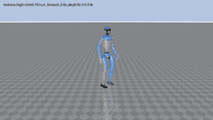
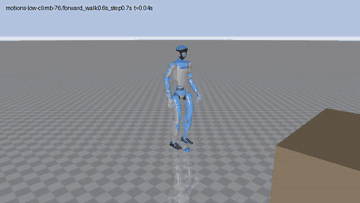
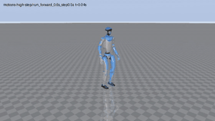
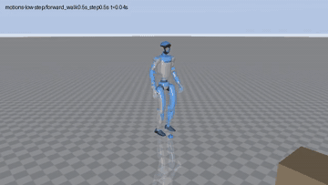
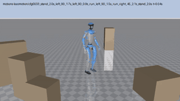
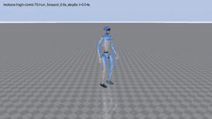
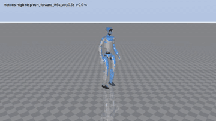

<!--
  Placeholders: every "TBD" cell and every block marked TODO is to be filled in once the runs exist.
  Search for "TODO" and "TBD" before publishing. Numbers must come from runs in this repository.
-->

# ACP-G1 <!-- TODO: final project name -->

**Contact-planned whole-body mobility for the Unitree G1, trained through one differentiable world model.**
<!-- TODO: one-sentence headline result, e.g. "X % success on Y procedural terrain types after Z h on one GPU". -->

ACP-G1 implements *Humanoid Mobility via Attention-based Contacts* (He, Wen, Zhang et al., arXiv:2610.31608) on
the Unitree G1. It trains with SuperMimic instead of PPO: the policy learns by backpropagating imagined returns
through a learned world model. An attention-based **contact planner** reads a height scan, proprioception and a
goal, and predicts where each of 9 bodies (feet, knees, hands, elbows, pelvis) makes its next contact. A
**contact tracker** turns these targets into joint commands. Motion data is used only as a training prior. The
final stage fine-tunes both networks on procedural terrains for which no reference motion exists.

It runs on [mjlab](https://github.com/mujocolab/mjlab) / MuJoCo Warp and trains on the
[PHP parkour](https://github.com/amazon-far/php_parkour) G1 motion bundles (296 clips, 1.0 h, 50 fps, each clip
with its own box terrain in 10 variants).

> **TODO: release note.** Version, date, and what the release contains, for example "v1.0 (YYYY-MM-DD): Stages 1–3,
> procedural goal-reaching terrains, evaluation on N terrain types". Link [CHANGELOG.md](CHANGELOG.md) once it
> exists.

| high climb (76 cm boxes) | low climb (76 cm boxes) |
|---|---|
|  |  |
| **high step** | **low step** |
|  |  |
| **locomotion** | |
|  | |

*The Stage 1 contact tracker (`logs/acp_stage1_ft/ckpt_004000.pt`, see [Stage 1](#stage-1-contact-tracker-on-reference-targets))
following one complete clip of each motion folder in simulation (MuJoCo Warp), first terrain variant, without noise.
Solid: the simulated robot; translucent blue: the reference clip; spheres: the commanded contact targets (feet red /
blue, knees orange, hands green). Real time, rendered by `supermimic.acp.render`.*

**Stage 2: the planner chooses the contacts.** The co-trained tracker follows only the planner's targets (η_obs = 1);
the reference serves only for the goal command and for scoring.

| high climb (76 cm boxes) | low climb (76 cm boxes) |
|---|---|
|  |  |
| **high step** | **low step** |
|  |  |
| **locomotion** | |
|  | |

*Stage 2 (`logs/acp_stage2_tw/ckpt_040000.pt`, see [Stage 2](#stage-2-planner)) on one complete clip of each motion
folder, with the training action noise (σ = 0.1) and the ±2 s termination window. The same clips as above, except the
high climb, which fails at 38 % of its clip here (`run_forward_0.6s_step0.8s`); another high climb is shown instead.
Spheres: the planner's targets. The robot lags the translucent reference: the planner sets its own pace.*

| on 1× RTX PRO 5000 Blackwell | Stage 1 tracker | Stage 2 (planner targets) | **Stage 3** |
|---|---|---|---|
| seeds | 1 | 1 | TBD |
| training time | 5.4 h (4.6 + 0.7 fine-tune) | 0.7 h planner + 14.7 h co-training | TBD |
| reference clips: normalized return / failed clips (of 296) | 0.835 / 4 | 0.56 / 8 (±2 s window, action noise) | TBD |
| goal reaching: success over all terrain types and levels | — | TBD (zero-shot) | TBD |
| contact placement error, feet (median, cm) | 10.0 / 10.2 | 4.2 / 3.9 | TBD |
| planner F1, feet / knees / hands | — | 0.90 / 0.95 / 0.86 (left) | TBD |

All numbers come from runs in this repository. TODO: say where each run's logs are kept (e.g. `results/runs/`) and
which script regenerates the tables. Read [How to read these numbers](#how-to-read-these-numbers) before quoting
them.

**Contents:** [Overview](#overview) · [Differences from the paper](#differences-from-the-paper) ·
[Results](#results) · [How to read these numbers](#how-to-read-these-numbers) · [Setup](#setup) ·
[Training](#training) · [Evaluation](#evaluation-and-metrics) · [Reproducing the tables](#reproducing-the-tables) ·
[Repository layout](#repository-layout) · [Contributors](#contributors) · [Attribution and licenses](#attribution-and-licenses) ·
[Citation](#citation)

---

## Overview

<!-- TODO: pipeline figure, e.g. media/pipeline.png: planner -> targets -> tracker -> simulator / world model. -->

Two networks run at 50 Hz. Every quantity is expressed in the pelvis heading frame (origin at the pelvis, rotated by
its yaw only), so deployment needs no global odometry.

| network | inputs | output |
|---|---|---|
| **Contact planner** (paper Table S3, attention) | 17 × 11 height scan (0.1 m cells, 1.6 × 1.0 m), 5 steps of proprioception, goal command | per body: the top-1 terrain point of its next contact within 1.5 s, and an occupancy (contact or not) |
| **Contact tracker** | 10 steps of proprioception, the 9 contact targets, goal command, 9 × 7 local height scan (0.8 × 0.6 m) | joint position targets (PD at 200 Hz) |

The goal command is the paper's bounded direction d_xy / max(‖d_xy‖, r) and a relative heading. r is 0.3 m toward
the reference 0.5–1.5 s ahead and 0.5 m toward a terrain goal. The world model and the critics also see an exact
height scan of the terrain in every stage.

The training follows the paper's three stages:

| stage | script | what trains | episodes |
|---|---|---|---|
| labels | `make_labels` | per-frame contact labels of every clip and terrain variant (MuJoCo `mj_geomDistance`) | — |
| data | `refine_motion`, then `make_labels` again | the clips cleaned against their terrain: no penetration, bodies in contact exactly on the surface | — |
| 1 | `train_stage1` | tracker, on reference contact targets (terrain points of contacts ≥ 10 steps) | reference clips, backward curriculum |
| 2, offline | `train_planner_offline` | planner, on hindsight labels of the frozen tracker | reference clips, uniform start phase |
| 2 | `train_stage2` | tracker + planner; η_obs and η_rew hand the tracker over to the planner's targets | reference clips, uniform start phase |
| 3 | `train_stage3` | tracker + planner on reference following and goal reaching, two critics | reference clips from frame 0 + procedural terrains |

**Procedural terrains (Stage 3).** These are built from boxes: 9 types × 10 difficulty levels × N random instances,
each rotated by a random yaw.

| type | course | difficulty (level 0 → 9) |
|---|---|---|
| stairs_up / walled_stairs | 4–6 steps up to a landing (walls on both sides) | step height 5 → 20 cm |
| stairs_down | start on a landing, 4–6 steps down | step height 5 → 20 cm |
| platform | walk-up platform of random orientation | 10 → 40 cm |
| climb | climbable obstacle | 40 → 85 cm |
| gap | start platform, gap, goal platform | gap 10 → 60 cm |
| stepping_stones | 6 stones between two platforms | stones 45 → 25 cm, gaps 5 → 35 cm |
| balance_beam | beam between two platforms | width 50 → 20 cm |
| pallets | narrow slats with gaps | slats 20 → 10 cm, gaps 5 → 25 cm |

## Differences from the paper

The baseline is the paper's three-stage pipeline. Where this implementation deviates, the reason is either the
learner (gradients through a world model, not PPO), the robot or the data.

| aspect | paper | here | why |
|---|---|---|---|
| tracker learning | PPO | SuperMimic: BPTT through 32 imagined steps of one world model, critic bootstrap | method choice |
| contact detection | contact forces | signed distance of a sphere approximation of each body's collision geoms to the terrain (24 spheres per convex mesh) | differentiable, available on imagined states |
| reward indicators (Stage 3) | 0/1 | sigmoids at the same thresholds | an indicator gives no gradient through the world model |
| advantage normalization per group (Stage 3) | yes | each group's imagined return divided by an EMA of its own spread | no advantages without PPO |
| stumbling term | yes | not used | needs contact forces |
| terrains | ladders, get-up, scanned meshes, … | box-built types only (table above) | box slots per simulated world |
| goal-buffer eviction | quality-based (positive work per goal distance) | FIFO per terrain type, sampling balanced across types | simplification |
| fall termination | not specified | pelvis < 0.25 m above the terrain, or tilt 1 − R_zz > 0.8 | just beyond the G1 references' extremes (0.345 m, 0.695) |
| perception | LiDAR neural mapping | exact height scan from the box geometry, Gaussian noise 3 cm (planner) / uniform 5 cm (tracker) | simulation only; TODO: mapping noise model |
| domain randomization | Table S2 | friction U(0.3, 1.2), joint offsets ±0.01 rad, torso CoM offset; no pushes | TODO: match Table S2 if needed |
| motion data | retargeted with minimum-distance and contact constraints | PHP parkour clips as published, then `refine_motion`: a whole-trajectory IK over root pose and joints keeps the bodies on the clip, out of the terrain, and on the surface during the clip's contacts | the published clips leave planted feet up to ~4 cm above or inside the boxes and palms up to 9 cm inside them |
| hand collision | not specified | the rubber-hand mesh collides (the MJCF has no hand collision geom) | the climbs put the palms on the boxes |

TODO: anything else changed before release (e.g. hyperparameters tuned per stage).

## Results

Setup for all runs: TODO GPU, TODO CPU threads, 4096 parallel environments. The software stack is mjlab 1.6.0,
MuJoCo / MuJoCo Warp 3.11, Warp 1.16, and torch 2.9.0 + CUDA 12.8. TODO: checkpoint interval, and whether
evaluation time is excluded from training time.

### Stage 1: contact tracker on reference targets

TODO: learning curve, e.g. results/stage1_curve.png.

| run | seeds | iterations | time (h) | return ↑ | failed (of 296) ↓ | touch precision / recall, feet ↑ | placement err feet (cm) ↓ |
|---|---|---|---|---|---|---|---|
| `acp_stage1_ft`, ckpt 4000 | 1 | 30,000 on the published clips + 4,000 on the refined clips | 0.73 (fine-tune only) | 0.835 | 4 | 0.93 / 0.98, 0.91 / 0.98 | 10.0, 10.2 |

The fine-tune starts from iteration 30,000 of a run on the published clips and trains on the refined clips with
`--target_min_steps 4`. Later checkpoints of both runs are worse on this evaluation (8,000: 21 failed) although the
training statistics keep improving; the cause is not identified yet. Evaluation: `supermimic.acp.evaluate`, every
refined clip once from its first frame, first terrain variant, no noise.

Per motion folder:

| folder | return | fail rate |
|---|---|---|
| motions-low-step | 0.867 | 0.018 |
| motions-high-step | 0.819 | 0.000 |
| motions-low-climb-76 | 0.828 | 0.000 |
| motions-high-climb-76 | 0.749 | 0.075 |
| motions-locomotion | 0.863 | 0.000 |

### Stage 2: planner

Planner offline on the frozen tracker. The validation set is every 10th clip of each folder:

| body | F1 ↑ | median top-1 error (cm) ↓ | within 0.1 m ↑ |
|---|---|---|---|
| feet (L / R) | 0.90 / 0.89 | 7.2 / 7.2 | 70 % / 70 % |
| knees (L / R) | 0.95 / 0.73 | 7.9 / 7.7 | 69 % / 68 % |
| hands (L / R) | 0.86 / 0.92 | 8.2 / 7.2 | 64 % / 77 % |
| elbows (L / R) | — | — | — |
| pelvis | — | — | — |

`logs/acp_planner_ft/planner_020000.pt`, 20,000 steps (0.7 h) on the Stage 1 tracker `ckpt_004000`. Elbows and pelvis
hardly touch the terrain in these clips: no validation contact.

Co-training (`train_stage2`, 40,000 iterations from the Stage 1 tracker): η_obs ramps over 2k–22k iterations, η_rew
over 12k–32k. From 24k on, the run continues with `--term_window 2 --eta_rew_max 0.58` (`logs/acp_stage2_tw`). Tracker
driven by planner targets only (η_obs = 1), ±2 s termination window, the training action noise (σ = 0.1):

| checkpoint | return ↑ | failed (of 296) ↓ | high climb | low climb | high step | low step | locomotion |
|---|---|---|---|---|---|---|---|
| 24,000 | 0.59 | 10 | 12.5 % | 7.5 % | 0 % | 0 % | 2 % |
| 40,000 | 0.56 | 8 | 10 % | 7.5 % | 0 % | 0 % | 1 % |

The return measures timing against the reference; it is lower than Stage 1's because the robot keeps its own pace
(it lags the reference by up to 2 s, inside the window). With the strict reference-anchored termination the same 40k
checkpoint "fails" most climbs and steps on lateness alone, the robot still standing.

**Evaluate with the training action noise.** Without it (`supermimic.acp.evaluate` without `--train_noise`) the same
checkpoints fail far more: 165 of 296 at 40k, and the Stage 1 tracker at 44k fails 170 instead of 7. Observation,
target or scan noise alone does not recover them, and a noisy previous-action input alone does not either; the
action noise has to reach the robot, and σ = 0.05 is not enough (101 failed). The world model and the critic only
ever see rollouts with σ = 0.1; why the noise-free policy degrades is not identified yet. Use `--train_noise action`.

### Stage 3: goal reaching

TODO: figure of success per terrain type and level, e.g. results/stage3_levels.png.

| terrain type | success ↑ | fall ↓ | time to goal (s) | highest level held |
|---|---|---|---|---|
| stairs_up | TBD | TBD | TBD | TBD |
| stairs_down | TBD | TBD | TBD | TBD |
| walled_stairs | TBD | TBD | TBD | TBD |
| platform | TBD | TBD | TBD | TBD |
| climb | TBD | TBD | TBD | TBD |
| gap | TBD | TBD | TBD | TBD |
| stepping_stones | TBD | TBD | TBD | TBD |
| balance_beam | TBD | TBD | TBD | TBD |
| pallets | TBD | TBD | TBD | TBD |
| **all** | TBD | TBD | TBD | — |

Reference following kept during Stage 3:

| | Stage 2 | Stage 3 |
|---|---|---|
| return / failed clips | TBD | TBD |

### Ablations

Each row changes one thing from the main configuration.

| configuration | seeds | metric 1 | metric 2 |
|---|---|---|---|
| main configuration | TBD | TBD | TBD |
| blind tracker (`--blind`) | TBD | TBD | TBD |
| SuperMimic tracking reward instead of the paper's (`train_stage1 --reward supermimic`) | TBD | TBD | TBD |
| no backward curriculum (`--no-backward_curriculum`) | TBD | TBD | TBD |
| reference termination window (`--term_window 0.5`) | TBD | TBD | TBD |
| TBD | TBD | TBD | TBD |

### What did not help

TODO: list the configurations tried and not adopted, with numbers, as in the ablation table.

## How to read these numbers

- **Simulation only.** TODO: state whether any number comes from hardware.
- **Exact perception.** The planner's height scan is computed from the box geometry with added noise, not from a
  sensor pipeline. Results on a real robot depend on the mapping.
- **Evaluation noise.** MuJoCo Warp on the GPU is not bit-deterministic. TODO: report how much re-evaluating one
  checkpoint moves each metric.
- **Seeds.** TODO: the number of seeds per row, and whether the tables show the mean, the median or the best seed.
- **Terrain bank.** Stage 3 trains and evaluates on the same generator (seed 0 by default).
  `evaluate_goal --terrain_seed` gives unseen instances of the same types. TODO: report both.
- TODO: anything specific to comparing against the paper (different robot data, different learner, no PPO
  baseline here).

## Setup

**Requirements:**
- Linux x86_64.
- An NVIDIA GPU with a driver for CUDA 12.8. TODO: tested GPU and driver.
- Python 3.10–3.13, `git`, `curl`.
- About TODO GB of GPU memory at 4096 environments. The replay buffer alone takes about 7.5 GB, since it must hold
  the longest episode (1326 frames).

```bash
git clone --branch feat/tienkung3-29dof-acp https://github.com/JStone2934/ACP_supermimic_Tienkung.git
cd ACP_supermimic_Tienkung
conda env create -f environment.yml
conda activate acp_supermimic
bash tools/download_acp_data.sh  # G1 model, five PHP bundles (296 clips), MJCF, and contact labels
python -m tools.check_acp_setup  # CUDA compile/backward, all clips/labels, 16 GPU simulation steps
```

The downloader verifies the PHP archives and extracted files against the upstream SHA-256
manifest, and verifies the G1 files against Hugging Face's hashes. Downloads go to
`data/g1_description` and `data/php_parkour`; generated labels go to `data/php_parkour_contacts`.
Re-running the script reuses verified assets and regenerates the MJCF and labels.

`tools/setup.sh`, `tools/download_data.sh`, and `run_train.sh` belong to the separate
upstream **Isaac Lab 3.0.0 kit-less Docker** workflow described in
[docs/supermimic_isaaclab.md](docs/supermimic_isaaclab.md). ACP-G1 uses mjlab directly
and does not require that Docker environment.

## Training

```bash
python -m supermimic.acp.train_stage1 --log_dir logs/acp_stage1
python -m supermimic.acp.train_planner_offline --tracker logs/acp_stage1/ckpt_060000.pt --log_dir logs/acp_planner
python -m supermimic.acp.train_stage2 --init logs/acp_stage1/last.pt --planner_init logs/acp_planner/planner_020000.pt --log_dir logs/acp_stage2
python -m supermimic.acp.train_stage3 --init logs/acp_stage2/last.pt --log_dir logs/acp_stage3
```

Settings travel in each checkpoint (`ctc_cfg`, `reward_cfg`, `planner_cfg`, `goal_cfg`, `terrain_args`), and
later stages rebuild them from there. `--resume <last.pt>` continues a run. TODO: wall-clock time of each stage.

Main flags:

| script | flag | default | meaning |
|---|---|---|---|
| all | `--num_envs` | 4096 | parallel simulated robots |
| all | `--horizon` | 32 | imagination horizon |
| all | `--seed` | 0 | random seed |
| `train_stage1` | `--iterations` | 60000 | |
| `train_stage1` | `--blind` | off | drop the tracker's 9 × 7 height scan |
| `train_stage1` | `--reward` | `paper` | `paper` (Stage 1 reward) or `supermimic` (tracking reward + contact labels) |
| `train_stage1` | `--backward_curriculum` | on | the paper's start-phase curriculum |
| `train_planner_offline` | `--steps` | 20000 | simulator steps |
| `train_stage2` | `--u_obs`, `--u_rew`, `--n_ann` | 2000, 12000, 20000 | η_obs / η_rew ramps (Eq. 3), in iterations |
| `train_stage2` | `--hold_admit` | 0.6 | pause the ramps while the hindsight admission rate drops below this share |
| `train_stage2`, `train_stage3` | `--term_window` | 0 | s: tolerance of the reference termination to being early or late |
| `train_stage3` | `--goal_frac` | 0.5 | share of goal-reaching environments and imagination samples |
| `train_stage3` | `--critic_warmup` | 500 | iterations before goal samples enter the actor loss |
| `train_stage3` | `--terrain_instances`, `--terrain_seed` | 16, 0 | the procedural terrain bank |
| `train_stage3` | `--start_level` | 0 | goal environments start at a uniform level up to this |

## Evaluation and metrics

```bash
# every clip once from its first frame, reference targets or the planner's
python -m supermimic.acp.evaluate --ckpt logs/acp_stage2/ckpt_040000.pt --planner logs/acp_stage2/ckpt_040000.pt [--record traj.npz]
# every procedural terrain type and level
python -m supermimic.acp.evaluate_goal --ckpt logs/acp_stage3/ckpt_030000.pt --episodes 4
```

Protocol: no randomization, no observation noise, deterministic policy, friction 1.0, each clip on its first valid
terrain variant. Results go to a json next to the checkpoint.

Definitions:
- *Normalized return*: the SuperMimic tracking reward summed over the clip, divided by its maximum. A clip fails if
  the training termination triggers.
- *Touch precision / recall*: per body, frames touching the terrain (sphere approximation within 1 cm) against the
  reference labels.
- *Placement error*: per body, the distance from where each new contact lands to the nearest target commanded over
  the last 5 steps.
- *Planner F1 / top-1 error*: occupancy F1, and the distance from the top-1 point to the hindsight label, on
  held-out clips.
- *Goal success*: within 0.5 m horizontally and 0.1 m vertically of the goal, with no fall before the episode ends
  (15 s).

TODO: any further metric added for the tables (e.g. foot slip, penetration).

## Reproducing the tables

TODO: the exact command lines (seeds, iterations, checkpoints), the script that collects the evaluation jsons into
the tables, and where the figures are written.

## Repository layout

| path | contents |
|---|---|
| `supermimic/acp/g1.py`, `kinematics.py` | G1 entity (BeyondMimic actuators), contact bodies; differentiable FK |
| `supermimic/acp/terrain.py`, `motion.py` | PHP clip boxes in all terrain variants, height scans, box distances; motion library |
| `supermimic/acp/mdp.py`, `networks.py`, `buffer.py` | observation, tracking reward, termination; world model, policy, critic; replay buffer |
| `supermimic/acp/env.py` | batched mjlab simulator with per-world box slots, reference and goal-reaching worlds |
| `supermimic/acp/task.py` | contact command, sphere geometry of the bodies, the paper's Stage 1 reward |
| `supermimic/acp/planner.py` | attention planner, hindsight labels, planner replay buffers |
| `supermimic/acp/goal.py` | procedural terrains, goal reward and termination, terrain curriculum |
| `supermimic/acp/make_labels.py` | contact labels of the motion set |
| `supermimic/acp/train_stage1.py`, `train_planner_offline.py`, `train_stage2.py`, `train_stage3.py` | the training stages |
| `supermimic/acp/evaluate.py`, `evaluate_goal.py` | evaluation on the clips and on the procedural terrains |
| `supermimic/*.py`, `tools/`, `docker/` | the upstream SuperMimic reproduction on Isaac Lab 3 (LAFAN1 tracking); see [docs/supermimic_isaaclab.md](docs/supermimic_isaaclab.md) |
| `results/` | TODO: tables, figures, per-run logs |
| `media/` | TODO: videos and figures for this page |

## Contributors

| | role |
|---|---|
| [Vu Dinh Quang](https://github.com/Quangvuisme) | project lead: direction, experiments, review |
| [Claude](https://claude.com/claude-code) (Anthropic, Claude Code) | implementation of the pipeline, documentation |

## Attribution and licenses

- **Method.** J. He, K. Wen, C. Zhang, C. Schwarke, Z. Zhang, K. Qu, S. Hu, M. Müller, V. Koltun, M. Hutter,
  *Humanoid Mobility via Attention-based Contacts*, arXiv:2610.31608, 2026. This is an independent implementation,
  not affiliated with or endorsed by the authors.
- **Learner.** Q. Liao, Y. Shao, J. Long, K. Zakka, R. Horowitz, P. Abbeel, K. Sreenath, *SuperMimic: Scaling
  Humanoid Whole-Body Control with One Differentiable World Model*, arXiv:2610.28480, 2026.
- **Code base.** Built next to [`supermimic_vibed`](https://github.com/zita-ch/supermimic_vibed) by Chong Zhang
  (ETH Zurich), an unofficial SuperMimic reimplementation, MIT License. TODO: the license of this project's own
  code.
- **Data.**
  - PHP parkour G1 motion and terrain bundles, from [amazon-far/php_parkour](https://github.com/amazon-far/php_parkour).
    TODO: the license of the data bundles (the repository's code is Apache-2.0).
  - Unitree G1 description (BSD-3-Clause), via the Hugging Face dataset
    [`lvhaidong/LAFAN1_Retargeting_Dataset`](https://huggingface.co/datasets/lvhaidong/LAFAN1_Retargeting_Dataset).
  - The data is not redistributed in this repository.
- **Simulation.**
  - [mjlab](https://github.com/mujocolab/mjlab) (Apache-2.0).
  - [MuJoCo](https://mujoco.org) and [MuJoCo Warp](https://github.com/google-deepmind/mujoco_warp) (Apache-2.0).
  - [NVIDIA Warp](https://github.com/NVIDIA/warp) (Apache-2.0).
  - [PyTorch](https://pytorch.org) (BSD-3-Clause).
  - All are used unmodified.

## Citation

If you use this code, please cite this repository and the works it builds on:

```bibtex
@misc{acpg1_2026,
  title  = {TODO: project title},
  author = {TODO},
  year   = {2026},
  url    = {TODO}
}
@article{he2026attentioncontacts,
  title   = {Humanoid Mobility via Attention-based Contacts},
  author  = {He, Junzhe and Wen, Kehan and Zhang, Chong and Schwarke, Clemens and Zhang, Zewei and Qu, Kaixian and Hu, Siyuan and M{\"u}ller, Matthias and Koltun, Vladlen and Hutter, Marco},
  journal = {arXiv preprint arXiv:2610.31608},
  year    = {2026}
}
@article{liao2026supermimic,
  title   = {SuperMimic: Scaling Humanoid Whole-Body Control with One Differentiable World Model},
  author  = {Liao, Qiayuan and Shao, Yiyang and Long, Junfeng and Zakka, Kevin and Horowitz, Roberto and Abbeel, Pieter and Sreenath, Koushil},
  journal = {arXiv preprint arXiv:2610.28480},
  year    = {2026}
}
@misc{zakka2026mjlab,
  title         = {mjlab: A Lightweight Framework for GPU-Accelerated Robot Learning},
  author        = {Zakka, Kevin and Liao, Qiayuan and Yi, Brent and Le Lay, Louis and Sreenath, Koushil and Abbeel, Pieter},
  year          = {2026},
  eprint        = {2601.22074},
  archivePrefix = {arXiv}
}
```


## TienKung 3.0 29 DoF integration

The `tienkung3_29dof` robot is integrated through an instance-local RobotSpec alongside the default G1. This delivery covers pinned assets, generic configuration, full-tree FK/contact numerical validation, and synthetic standing integration checks. It does **not** establish trained standing, walking, climbing, or Stage 2/3 task performance.

See [reproduction and evidence](docs/tienkung3_29dof/README.md), [design](docs/tienkung3_29dof/design.md), [progress](docs/tienkung3_29dof/progress.md), and [task memory](docs/tienkung3_29dof/taskmemory.md). Large assets, motion fixtures and checkpoints are generated under ignored data/logs directories.

### Public TienKung 3.0 motion data

Checked on **2026-11-07**. Official xMimic provides three downloadable **29 DoF motion examples**.
We have not found a TienKung 3.0 release equivalent to the G1 PHP collection of 296 parkour clips
and paired terrain variants. The resources below are candidates for further integration;
they have not been converted or validated for ACP tracking in this repository.

| Resource | Available data | Fit for this project |
|---|---|---|
| [xMimic 29 DoF examples](https://github.com/Open-X-Humanoid/xMimic/tree/0385122a232279210e941c7bb28da6a0bbb42356/motion_example/29dof) | Three NPZ clips, 100 Hz, about 124 seconds total; joint and world body poses/velocities | Best initial full-body motion candidates; format adaptation and motion quality checks required |
| [TienKung-Lab TienKung 3 datasets](https://github.com/Open-X-Humanoid/TienKung-Lab/tree/ffea8bde32fcb632b5ef2a700e452f99e907ea40/legged_lab/envs/tienkung3/datasets) | Walk/run visualization and AMP files | Walking bootstrap candidate; the inspected visualization walk contains root motion and 20 joint positions, requiring completion to 29 DoF |
| [HEX TienKung 3 datasets](https://huggingface.co/datasets/X-Humanoid/HEX-Datasets/tree/main/pretrain/tiangong3) | 19 task directories, including ball handling, carrying and picking up objects while walking | LeRobot manipulation demonstrations; not a ready-to-load PHP motion/terrain library |

The downloaded xMimic files were inspected with NumPy and compared with this repository's target model:

| File | Frames | Duration at 100 Hz | Maximum joint-limit violation against the local model |
|---|---:|---:|---:|
| `dance1_easy.npz` | 3,982 | 39.81 s | 1.12 degrees |
| `dance2_medium.npz` | 7,099 | 70.98 s | 4.00 degrees |
| `weibst_hard.npz` | 1,335 | 13.34 s | 5.00 degrees |

Durations use `(frames - 1) / fps`. All numeric arrays were finite and body quaternions were normalized.
The 29 joint names match our target model, but their order differs. These checks do not establish
collision-free motion, dynamic feasibility or successful tracking; the limit violations need to be
resolved before accepting the clips as training references.

To adapt xMimic data, extract the `pelvis` pose by `body_names`, reorder joints by name, and construct
ACP's `joint_pos = root_xyz + root_quat_wxyz + joint_angles` array of shape `(T, 36)`.
The source `joint_pos` has shape `(T, 29)` and does not include the root. Resample to 50 Hz,
verify model compatibility, write the required robot metadata and a paired empty flat-terrain file,
then recompute FK, velocities and contact labels with the target model. No automatic xMimic
conversion is implemented yet; `tools/download_acp_data.sh` still downloads G1 assets and PHP data only.

For HEX, the inspected walking-and-picking task contains leg joint observations but no explicitly
documented world root-pose field. Its action representation is also different from ACP's reference
trajectory. The [official HEX documentation](https://github.com/Open-X-Humanoid/HEX/blob/fe9ee4870c90f2c4c362e36e3202324523c0dda9/readme.md)
states that the TienKung low-level whole-body controller is not released.

Start with `dance1_easy` and the official walking reference for small-scale tracking experiments.
PHP-style steps and climbing still require contact-constrained retargeting of the G1 clips or new
motion collection. The [inspected xGMR registry](https://github.com/Open-X-Humanoid/xGMR/blob/70f08d75f5e03aa06ed6d521451bd1e6888f5c0f/general_motion_retargeting/params.py)
does not register `tiangong3`, despite the example in xMimic's README, so that retargeting command
must not be assumed to work without completing the target configuration.

These links establish public availability. xMimic's README displays an MIT badge, but the inspected
revision contains no standalone LICENSE/COPYING or separate motion-data license; no additional
data license is asserted here. See the [Chinese data notes](docs/tienkung3_29dof/README.md#公开动作数据调研2026-11-07)
for the corresponding integration guidance.
