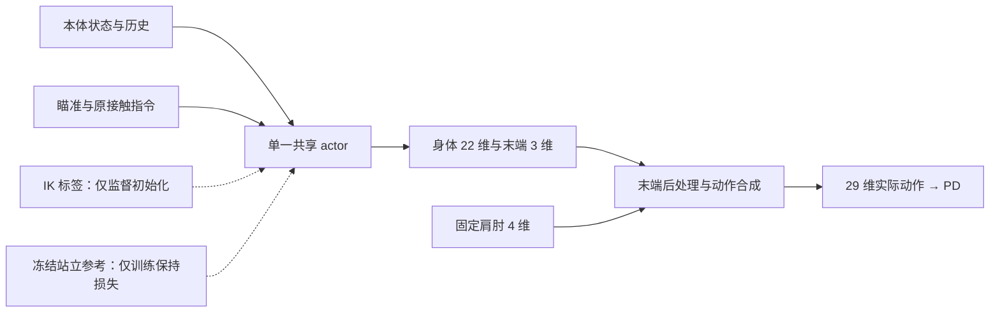

# 控制、目标几何与奖励设计

更新：2026-11-11（Asia/Shanghai）。返回 [入口](README.md)；教师见 [监督初始化](ik_pretraining.md)，阶段和验收见 [课程](curriculum.md)。本文件规定后续实现，除明确引用的现有接口外，均尚未接入源码。

## 1. 控制对象与动作合成

| 组 | 关节／控制者 | 输出约定 |
|---|---|---|
| 身体 22 维 | 双腿 12、腰部 3、左臂 7；同一个 actor | 沿用现有归一化动作 |
| 固定 4 维 | `shoulder_pitch_r_joint`、`shoulder_roll_r_joint`、`shoulder_yaw_r_joint`、`elbow_pitch_r_joint` | `(0.20, -0.10, 0.00, -π/2) rad` |
| 末端 3 维 | `elbow_yaw_r_joint`、`wrist_pitch_r_joint`、`wrist_roll_r_joint`；同一个 actor | 三维网络动作解码为绝对关节位置目标，物理单位 rad |

肩肘保持是相对上游连杆的 PD 目标，不焊接关节或基座。末端三个关节初始目标均为零；实际肩肘误差仍参与 FK，不能用指令角替代传感状态。模型行程约为前臂旋转 ±163°、两个腕关节各 ±76°，但这不是整个系统的可瞄准范围。

现有控制周期 `dt=0.02 s`、物理周期 `0.005 s`，动作约定为：

```text
q_target = q_default + joint_offset + action_scale * action
action_scale = 0.25  # 当前天工配置；实现按 RobotSpec 读取
```

统一合成流程：

1. 一个 actor 前向得到 `a_raw = π(obs_history, concat(contact_command, aim_command))`，保留 29 维接口，实际使用身体 22 维和末端 3 维，仅覆盖固定四维。
2. 末端三维解码为 `q_terminal_raw = q_default_terminal + action_scale_terminal * a_raw_terminal`。这里的默认角是固定模型常量，不是在线 IK 解或第二个网络输出；网络直接决定绝对位置目标。
3. 将末端输出限制在现有 `MDP.soft_lo/soft_hi` 内，按上一次实际下发的末端目标限速，得到 `q_terminal_des`。初始软件限速默认三个关节均为 `2 rad/s`，属于待验证参数。
4. 四个固定目标和三个后处理末端目标分别用 `(q_des - q_default - joint_offset) / action_scale` 转成实际归一化动作。身体 22 维直接使用 `a_raw`。当前标称任务 joint_offset 为零；偏置补偿只在此处应用一次。
5. 最终 29 维动作同时用于仿真、观测中的历史动作、动作变化惩罚、replay 和世界模型。

限速器初值采用重置时的实际末端角，并保存其状态。只在一个共享位置合成和限速，避免环境、采集器和想象步骤重复处理。网络输出和限速器均保留可用张量梯度；不在想象中引入 IK、NumPy 求解或无意的 `detach`。限速造成的滞后计入最终控制效果。



虚线表示训练损失提供监督，不是执行动作通路。最终部署只保留实线部分。

## 2. 世界目标与固定靶平面

### 2.1 坐标和采样

以已确认参考持臂姿态的 TCP 世界位置为 `h_ref`，初始单位指向为 `n0`：

```text
u_H = (0, 0, -1)
n0 ≈ (0.9800889, -0.0160003, -0.1979133)
e1 = normalize(world_up × n0)
e2 = n0 × e1
```

`e1` 为靶面的横向，`e2` 为竖向；正横向由上述叉乘定义，不额外假定它是机器人右侧。`h_ref`、`n0`、`e1`、`e2` 按参考姿态生成后固定，不能逐步跟随实际机器人更新。

令 `L` 表示沿 `n0` 的前向深度，靶面中心 `c0 = h_ref + L*n0`。采样两个独立投影角 `α、β` 后，目标中心为：

\[
g=c_0+L\tan(\alpha)e_1+L\tan(\beta)e_2.
\]

这里的 `α、β` 是横向／竖向投影角，不是欧拉角。靶面法向始终为 `n0`。从参考 TCP 到目标的实际距离为 `L*sqrt(1+tan²α+tan²β)`，运行中实际手靶距离 `D=||g-h||` 又会随身体和腕部运动变化。因此课程的“3 m 平面”“2–4 m 距离范围”分别指 `L=3 m`、`L∈[2,4] m`；实际 `D` 另行记录，不声称所有靶面点严格等距离。

中央目标取 `L=3 m, α=β=0`，沿初始方向向下约 11.4°。静态阶段只在回合开始时采样一次；切换和移动阶段才由明确的目标过程修改 `g`。深度随机时保持角范围不变，避免同时无意扩大方向范围。

### 2.2 实际误差和命中

每个控制步以实际 FK 计算 TCP 位置 `h`、旋转 `R_H`，并定义：

\[
d=R_Hu_H,\quad D=\|g-h\|,\quad u=(g-h)/D,\quad
\theta=\arccos(\operatorname{clamp}(d^Tu,-1,1)).
\]

令 `a=n0ᵀ(g-h)`、`b=n0ᵀd`，射线与目标所在平面的交点为：

\[
\lambda=a/b,\quad x_{hit}=h+\lambda d,\quad e=\|x_{hit}-g\|.
\]

有效条件为 `D>1e-6 m`、`a>0`、`b>1e-4`、`λ>0`，且所有量有限。无效交点标记 `valid_hit=false`，必定未命中；误差统计保留无效率，计算 P95 时将无效帧视为无穷误差，JSON 中无穷值写为 `null` 并附有效性标记，不当作零误差或静默删除。

容差半径为 `ρ`，命中定义为 `valid_hit && e<=ρ`。不能对方向点积取绝对值或平方来判定对准，否则反向指向可能被误判。

对于正对视线的靶面，`θ_tol=atan(ρ/D)`：

| 实际距离 D | ρ=20 cm | ρ=10 cm | ρ=5 cm |
|---|---:|---:|---:|
| 2 m | 5.71° | 2.86° | 1.43° |
| 3 m | 3.81° | 1.91° | 0.95° |
| 5 m（仅换算示例） | 2.29° | 1.15° | 0.57° |

离轴或身体运动后的靶面不一定正对视线，实际命中以交点公式为准。旧文档的 5° 初始建议在 3 m 正对靶面时对应约 26.2 cm，不能作为 20 cm 课程的等价判据。

## 3. 单 actor 迁移及任务输入

### 3.1 首版网络

复用现有 [Policy](../../../supermimic/acp/networks.py) 的目标编码器、共享动作解码器、10 帧历史和 29 维输出，不新增独立末端网络。目标编码器与身体／末端输出共享网络参数，保留旧层宽与激活函数。具体迁移如下：

1. 加载已验收站立 actor 的旧输入列、隐藏层、身体输出行及对应归一化统计。
2. 在现有 contact command 后追加下表瞄准条件，第一层新增输入列初始化为零；迁移刚完成时，新增目标不会扰动原站立输出。
3. 将最终输出层的末端三行权重初始化为零，bias 设为 `(q_home-q_default_terminal)/action_scale_terminal`，使其物理目标从三关节零角开始。原本被七关节覆盖隐藏的旧末端输出不能直接启用。
4. 固定肩肘四行仍由执行层覆盖；同一个 actor 的其余 25 行经过监督和后续强化学习共同优化。

网络输出层沿用线性动作接口，末端的软限位和限速使用第 1 节的统一后处理。不能仅将两个独立策略包装在同一个函数中就称为单 policy；最终控制必须来自上述同一次共享 actor 前向。

| 输入组 | 内容与来源 |
|---|---|
| 身体历史 | 复用现有关节位置／速度、身体角速度、重力和实际动作历史；包含固定肩肘的实际状态 |
| 目标相对位置 | `R_Bᵀ(g-h)`，`R_B` 为当前躯干 `waist_pitch_link` 的实际旋转 |
| 实际方向与靶面 | `R_Bᵀd`、`R_Bᵀn0` |
| 目标速度 | `R_Bᵀv_target_w`；静止目标和切换后驻留目标为零，跳变事件不伪装成巨大物理速度 |
| 精度条件 | 物理容差 `ρ` 与奖励宽度 `σ`，单位 m |
| 控制连续性 | 上一实际下发的三关节 rad 目标；重置时使用实际角度 |

`v_target_w` 是目标本身的世界速度在当前躯干系下的表达，不是相对位置的时间导数；身体运动由本体观测提供。目标、方向等条件按相同规则在每个想象步重算。首版仿真允许读取真实状态；未来实机需用可实现的定位和估计替换，不把未来目标轨迹作为 actor 的必要输入。

同一个 actor 和任务 critic 获取完整瞄准条件。旧 contact command 及原地站立含义保留，不能用瞄准目标替换移动或接触目标。共享层变化会同时影响身体与末端，即便冻结身体输出行也不保证原站立行为不变；监督阶段使用身体动作保持损失，并以实际闭环站立检查为准。

### 3.2 归一化与状态恢复

actor 的旧观测和 contact command 统计，以及世界模型的旧统计保持加载值。新增瞄准字段独立采用显式单位尺度后，与归一化的旧 command 拼接，再送入扩展后的同一编码器；不能把旧 RunningNorm 直接扩维并冻结为近零方差。目标位置除以 `3 m`、目标速度除以 `1 m/s`、`ρ` 和 `σ` 除以 `0.20 m`；单位方向保持原值，前一末端关节目标按软行程归一化。

critic 为新增任务条件重新初始化，新增字段使用同样的显式尺度；状态部分可按新任务数据初始化统计。所有尺度、特征顺序、历史长度和网络结构随检查点保存。

## 4. 连续奖励

### 4.1 训练信号与真实靶面指标

靶面核函数直观地表达“越靠近中心越高分”：`K(e,σ)=1/(1+(e/σ)²)`。当 `σ=ρ` 时，中心、半径一半、半径边缘、两倍半径分别为 `1、0.8、0.5、0.2`。

世界模型训练需要连续且数值稳定的梯度。首版训练使用不含射线除法的近靶误差代理，避免 `b≈0` 时梯度爆炸：

\[
c=\operatorname{clamp}(d^Tu,-1,1),\quad
\widetilde e^2=2D^2(1-c),\quad
r_{dir}=(1+c)/2,\quad
r_{center}=\frac{1}{1+\widetilde e^2/\sigma^2},\quad
r_{aim}=0.2r_{dir}+0.8r_{center}.
\]

`ẽ` 是小角度、近正对靶面时的偏差近似，不是精确靶面交点误差；它的零点仍是正确指向。评估、成功率和课程升级始终使用精确 `e`，不能把代理成绩替代物理命中。反向指向的方向奖励为零、中心奖励很小，不会成为最优。无需对训练奖励使用 `acos` 或硬命中阈值。

初始 `σ=ρ=0.20 m`。收紧容差的第一次统计窗口暂取 `σ=max(ρ,ρ_previous)`，下一窗口改为 `σ=ρ`；目标已经固定的尝试在结束前不改变 `ρ、σ`。升级统计要求两批都使用最终 `σ=ρ`，过渡宽度的窗口只记录，不计升级连胜；连续失败仍可触发回退。

### 4.2 与站立奖励组合

保留现有站立根位置、脚位、水平速度、脚速和朝向项，其权重／尺度继续为 `2/0.10 m`、`2/0.05 m`、`1/0.10 m/s`、`0.5/0.10 m/s`、`0.5/5°`。保持原接触标签含义，瞄准目标不作为手部接触目标。

跟踪奖励只屏蔽发生冲突的部分：`right_tcp_link` 的旧参考位置、姿态及速度跟踪全部移除；末端三关节的旧轨迹跟踪在存在该项的奖励入口中移除。右肩和肘 pitch 使用持臂参考，右肘上游位置若不随末端三关节变化则继续保留，不整条删除右臂约束。

新增固定四关节保持奖励 `r_fixed=mean K(q_actual-q_hold,5°)`。初始权重 `w_aim=2`、`w_fixed=0.5`。自然姿态只作弱正则：`r_home=mean((q_terminal/soft_half_range)²)`，权重 `-0.01`，不能压过瞄准。

动作变化惩罚使用实际合成的归一化动作；身体与固定组沿用原系数 `-0.1`，末端组三维改用 `-0.02`，替换而非重复叠加原三维惩罚。保留现有关节限位项，不另加重复限位奖励。完整奖励按现有周期约定计算，新加的奖励率只乘一次 `dt`。

上述权重均为待验证起点。保留连续奖励，不采用“进圈即终止”或单次命中大额奖金；连续保持通过每步奖励获得收益，通过明确指标判定成功。

## 5. 成功、站立约束与失败

一次静态或切换目标尝试成功，须在捕获时限内开始一个完整的连续命中区间，长度不少于该阶段的保持要求；该尝试所在回合还必须满足站立要求。只有保持区间完成后才能确认其起点是捕获时间。

| 身体条件 | 瞄准阶段要求 |
|---|---|
| 回合 | 标称平地连续 30 s，无回合内重置，不施加外力 |
| 骨盆与双脚 | 相对回合初始位置，最大水平位移分别 ≤0.10 m、每只脚 ≤0.05 m |
| 根姿态 | 不跌倒，最大根倾角 ≤15° |
| 固定关节 | 肩部三关节＋肘 pitch 各自保持误差 P95 ≤5° |
| 末端三关节 | 评价指向、动作连续性和限位，不要求继续保持零角度 |

脚位继续采用现有踝部跟踪坐标。所有身体指标统计完整回合，不扣除捕获或起步段。身体漂移超标后，即便之后返回原位，该回合仍不通过最大位移条件。

瞄准暂时失误通常不终止回合，让策略学习恢复；跌倒、非有限状态等按现有物理终止处理。提前终止计为失败，不能因不足保持时长被删掉。移动目标的跟踪占比和失锁规则见 [课程](curriculum.md)。固定评估分开报告完整时段与预先规定的捕获后时段，不从轨迹中选取最好的片段作唯一指标。
