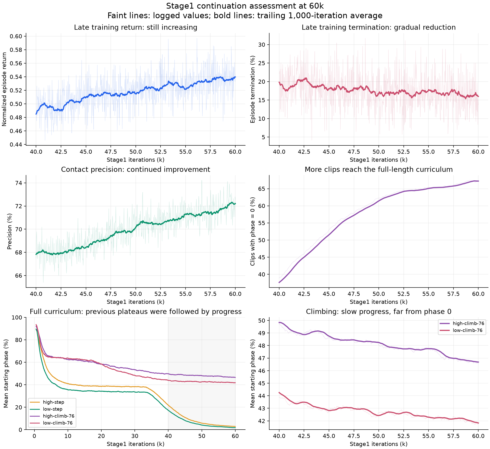

**Stage1 在 60k 时是否进入平台：末期训练曲线复核**

**判断：训练分布上的表现仍在改善，可以继续做一段有界续训；攀爬的改善很慢，尚不能承诺单纯增加轮数就能打通完整动作。** 当前数据不支持“60k 已整体收敛、再训练没有收益”。“攀爬尚未学会”和“训练已经停止改善”是两个不同判断。

本次只分析既有 Stage1 日志，没有启动训练或新增仿真评估。数据截止 60000 轮。统计使用等长 25 轮日志窗口的算术平均；图中粗线为过去 1000 轮移动平均。课程和采样分布持续变化，训练指标不等于固定评估集的成功率。

[数值证据](evidence/stage1_late_statistics.json) · [PDF 曲线](figures/stage1_late_training.pdf) · [分析脚本](../../../results/stage_training_analysis_20261111/stage1_late_trend.py)

**1. 整体改善在最后一万轮仍然持续。**

| 训练区间 | episode 回报 ↑ | 训练终止比例 ↓ | 接触 precision ↑ | 从头训练样本占比 ↑ |
|---|---:|---:|---:|---:|
| 40k–45k | 0.4999 | 19.00% | 68.14% | 46.17% |
| 45k–50k | 0.5144 | 17.74% | 69.52% | 58.00% |
| 50k–55k | 0.5251 | 17.01% | 70.76% | 64.08% |
| 55k–60k | 0.5351 | 16.44% | 71.62% | 66.21% |

最后两个 5000 轮窗口之间，回报相对提高约 1.9%，终止比例下降约 0.57 个百分点，接触 precision 提高约 0.86 个百分点。多个指标同向变化，支持仍有学习进展，而非单个指标的最后一点偶然变好。

缩小为 2000 轮窗口：50k–52k 回报 0.5227、终止比例 16.94%、接触 precision 70.51%；58k–60k 对应 0.5371、15.91%、72.06%。54k–56k 有一次小幅回撤，但随后继续改善。相邻窗口存在时间相关性，这些数字用于趋势判断，不宣称统计显著性。

**2. 攀爬存在明显瓶颈，但课程曲线还没有完全走平。**

以下是指定迭代时刻的课程状态，与上一张表的区间均值不同；起始位置越低，表示能从越早的参考状态开始练习。

| 类别 | 50k 起始位置 | 55k 起始位置 | 60k 起始位置 | 判断 |
|---|---:|---:|---:|---|
| 行走 | 0.080% | 0.045% | 0.050% | 课程基本到头，零附近小幅波动 |
| 低台阶 | 4.15% | 2.70% | 1.82% | 仍在改善，逐渐接近从头训练 |
| 高台阶 | 5.83% | 3.97% | 2.87% | 仍在改善 |
| 低攀爬 | 42.63% | 42.30% | 41.76% | 缓慢推进、瓶颈明显 |
| 高攀爬 | 48.05% | 47.75% | 46.54% | 缓慢推进，末期仍有进展 |

最后 10000 轮，低攀爬平均起点向前推进约 0.86 个百分点，高攀爬约 1.51 个百分点；最后 5000 轮分别推进约 0.54、1.21 个百分点。不能说攀爬完全没有进展，但进展距离从第一帧完成整段动作仍很远。

课程状态受每次 episode 成败影响，不能将单个起点变化等同于严格评估能力的同等变化。当前没有同协议的 40k/50k/60k 完整评估曲线，本次也未补跑，因此尚不能证明攀爬从头执行的成功率正在上升。

**3. 不能仅看 world-model loss 判断整个训练已经收敛。**

40k–60k 的世界模型 8 步归一化误差约在 0.213–0.217 附近波动，整体比策略回报更接近平稳。但其训练对象和策略状态分布在变化，这也不是独立验证误差；它不能替代策略能力指标。

60k 学习率为约 1.737×10⁻⁴，仍为初始 2×10⁻⁴ 的 86.9%，并没有衰减到接近零。保存的跳过更新记录为空，曲线没有表现出明显数值发散。现有证据不足以要求立即大幅改学习率。

完整课程曲线还显示：高、低台阶在约 10k–30k 曾长期推进缓慢，约 35k 后才明显突破。这说明阶段性平缓不一定等于永久停滞；也不能据此保证攀爬一定会复制相同的突破。

**4. 建议先从 Stage1 的 60k 完整断点续训到 80k，并设置检查点。**

这是后续执行建议，本次未启动：

- 使用 Stage1 60k 完整检查点恢复网络、优化器与课程状态，保持当前配置，以便判断额外轮数的收益。
- 每 5000 轮检查各类别课程起点、从头训练比例和训练回报；在 60k 基线、70k、80k 上按固定协议比较完整动作评估，重点看攀爬实际存活时间、空间误差、手部支撑过渡与完成数量。
- 若连续两个 5000 轮窗口中，攀爬课程无持续前移，且固定评估也无改善，再转向攀爬专项课程、动力学与接触机制诊断。避免用其他类别的进步替代攀爬进步。
- 若训练指标继续改善但完整攀爬仍然全失败，应记录为“部分技能仍在改善、完整任务尚未突破”，不能据此直接推进 Stage2 验收。

最后 5000 轮耗时约 0.538 小时，约 2.58 轮/秒。同配置增加 20000 轮的纯训练时间估计约 2.15 小时；恢复预热、评估及运行环境变化另计。

本次判断支持一段有限续训来验证收益，不支持把当前缓慢趋势线性外推成“再训练多少轮一定能完成攀爬”。
