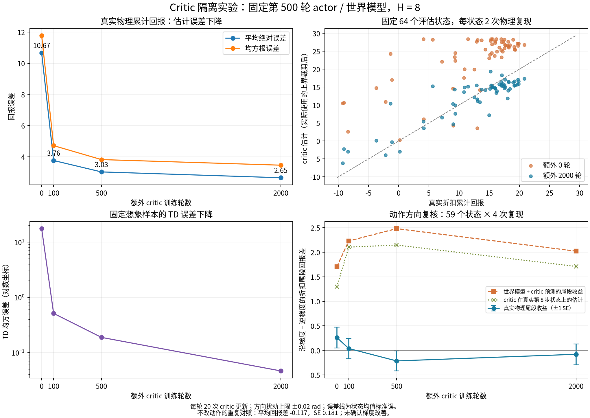
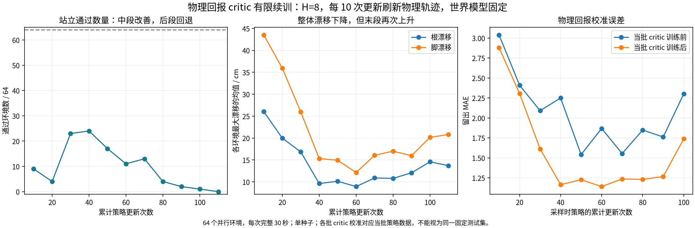

**H=8 站立瞄准训练报告：Critic 物理回报监督与策略更新退化**

报告日期：2026-11-14，北京时间。代码与原始实验记录基于提交 `5e0645665bc0af9bb5315f7ea9fb9c84179c7e37`。本报告整理已有结果，没有启动新训练。

**核心结论：让 critic 学习物理仿真中的实际回报，有助于改善价值估计和部分站立表现；但本次固定世界模型的简化试训中，持续更新 actor 仍使站立精度在中段改善后退化。现有证据不足以直接恢复长期训练。**

有限试训累计进行了 110 次 actor 更新。站立通过数在第 40 次达到本轮最高的 **24/64**，最终降到 **0/64**。最终没有跌倒，但 64 个环境的脚漂移全部超过原来的 **5 cm** 验收线。第 40 次候选已保留，它是本轮观测最佳模型，尚不是通过站立验收的正式起点。

正式服务 `aiming-fullbody-h8.service` 在报告整理时为 `inactive`、`MainPID=0`。所有有限诊断进程均已结束。

| 内容 | 入口 |
|---|---|
| 本报告的数值摘要 | [summary.json](evidence/summary.json) |
| 11 个策略检查点的完整指标表 | [continuation_metrics.csv](evidence/continuation_metrics.csv) |
| Critic 隔离实验图 | [critic_isolation.png](figures/critic_isolation.png) |
| 物理监督续训趋势图 | [physical_critic_continuation.png](figures/physical_critic_continuation.png) |
| 数据来源和校验信息 | [manifest.json](manifest.json) |
| H8 运行与修复记录 | [h8_restart.md](../../config/standing_aiming_fullbody_v2/h8_restart.md) |

**1. 研究的问题及已有修改。**

原训练主要有三个问题：右腕请求长期超出控制限位，硬裁剪使越界部分的运动学梯度为零；开始学习瞄准时，探索已经按累计策略更新衰减到较低水平；世界模型以 8 步窗口训练，而 actor 原来使用 32 步想象优化。

H8 正式实验已经实施以下修改：

- 想象长度改为 **H=8**。
- 保留实际执行限位，增加超限请求代价。越界请求本身产生回到范围内的梯度；WM、观测历史和物理执行仍使用实际执行的动作。
- 探索按课程阶段计数，进入新阶段恢复幅度，并保留未通过阶段的探索下限。
- 对 bootstrap 价值使用由最大奖励和剩余回合长度推导的上界。critic 回归仍使用未裁剪预测，使过高估计能够被纠正。

H8 运行从旧实验第 20000 轮迁移 actor 和 WM，**critic 与优化器重新初始化**。因此，后续问题不能简单解释为直接沿用了旧 H32 配置训练出的 critic。不过，新 critic 是否充分适应当前策略与奖励，仍需要检验。

H8 正式训练在用户要求下暂停：最后日志为第 1400 轮，最新完整检查点为第 1000 轮。后续隔离实验以第 500 轮检查点为固定来源；该检查点的 critic 已有 8000 次梯度更新，策略本身已经存在站立退化。

此前对旧 H32 第 26000 轮模型的独立预测重测中，误差随预测长度增长：

| 预测长度 | 根位置 P95 | 脚位置 P95 | 距离折算指向误差 P95 |
|---:|---:|---:|---:|
| 8 步 | 0.95 cm | 2.41 cm | 7.34 cm |
| 32 步 | 4.75 cm | 4.46 cm | 20.60 cm |

这些结果说明使用较短预测有依据，但不证明 H=8 的梯度已经可靠。这里的数据来自旧 H32 检查点，不能当作本次物理监督候选的 WM 验证结果；该旧报告的总 `passed=false` 也不能单独解释为 8 步预测未通过。

证据：[旧模型预测重测](../../../results/aiming_review_20261114/wm_026000_h8_retest.json)、[H8 配置](../../config/standing_aiming_fullbody_v2/h8_request_stage.json)。

**2. 计数、时间和验收标准的含义。**

| 名称 | 本报告中的含义 |
|---|---|
| 正式训练第 500 轮 | 提供模型和优化器状态的历史检查点身份 |
| H=8 | 每次 actor 优化向前想象 8 个控制步，约 0.16 秒 |
| 额外 critic 100/500/2000 轮 | 隔离实验中的训练轮数，每轮包含 20 次 critic 梯度更新 |
| 物理 critic 5000/2000 次更新 | 物理监督试跑中的实际优化器步数，不能与上一行的“轮”混写 |
| 累计 actor 更新 10/40/110 次 | 在源策略基础上，独立试训实际执行了多少次 actor 优化器更新 |
| 完整物理评估 | 每个环境最多运行 1500 个控制步，即 30 秒；真正终止后不再累计该回合的回报 |
| 前段、中段、后段 | 本次独立试训的时间顺序，分别大致指 actor 更新 10—20、30—60、70—110 次 |

第 40 次候选不是正式训练第 540 轮。所有物理监督试跑均停留在 **A 站立阶段**，没有进入 B1 瞄准学习。“64 个环境”指同一 A 阶段设置下的并行环境，不是 64 种独立瞄准任务。

每个环境的站立通过条件保持不变：完整完成 30 秒、没有真正终止或非有限状态、根水平最大漂移不超过 **10 cm**、每只脚水平最大漂移不超过 **5 cm**、最大倾角不超过 **15°**。

下文的“平均最大漂移”先对每个环境取整个有效回合的最大值，再对环境求均值；该均值低于阈值，不代表每个环境都通过。失败环境仍计为失败，不通过删除起始调整段或排除失败样本提高通过率。

**3. 暂停后的初步诊断：价值梯度占主导，但不等于每次更新都必然有害。**

源代码检查确认，原 critic 的目标来自 **WM 想象奖励与自身 bootstrap**，没有直接用 replay 中的真实物理奖励校准。第 500/1000 轮检查点中，末端价值项的 actor 参数梯度范数分别约为站立奖励项的 **34.4/27.6 倍**；总梯度与价值项梯度的余弦相似度都超过 **0.999**。第 500 轮较大的价值梯度通路是历史观测。

这说明价值项足以显著影响策略更新方向，但比例大本身不是错误判据。局部反事实测试中，一次小 Adam 更新也有改善真实短程表现的情况；把一次参数变化放大 10 倍的测试仅是敏感性探测，不能写成实际连续训练 10 次的结果。

因此，初步诊断支持“需要核对价值及其变化方向”，尚不能把站立退化归结为 critic 唯一原因。

证据：[梯度与反事实诊断](../../../results/aiming_update_diagnosis_20261114/diagnosis.json)。

**4. 实验一：固定 actor 和 WM，延长 critic 训练。**

本实验保持原想象监督方式，固定第 500 轮 actor、WM 及其归一化统计，只继续 critic 和其原有优化器状态。训练采用固定的 4096 个物理起点；64 个评估起点来自不同环境编号，每个起点执行两次固定确定性策略，直到真正终止或回合时限。

物理参考回报包含原奖励中的超限请求代价，使用 `gamma=0.99`，不含末端 bootstrap。训练与评估数据来自同一 A 阶段设置，不代表跨任务泛化。

| 额外 critic 轮数 | 额外梯度更新 | 固定想象样本 TD MSE | 物理回报 MAE | 平均估计回报 |
|---:|---:|---:|---:|---:|
| 0 | 0 | 17.470 | 10.667 | 22.777 |
| 100 | 2000 | 0.510 | 3.758 | 11.099 |
| 500 | 10000 | 0.188 | 3.026 | 11.620 |
| 2000 | 40000 | 0.046 | 2.651 | 12.063 |

表中 MAE 和平均估计采用实际使用的价值上界。物理参考回报均值固定为 **12.555**。64 个状态中有 62 个误差降低，MAE 降低约 **75.1%**，预测与真实回报的相关系数从 0.689 升至 0.896。延长训练确实改善了真实数值估计，并非只有训练损失下降。

动作方向复核采用 59 个非临近终止状态，每状态 4 次复现。对前 8 步动作施加沿 critic 末端价值梯度或逆梯度的扰动，之后执行同一个固定 actor。以下差值均为“沿梯度减去逆梯度”，扰动幅度上限为 0.02 rad：

| 额外 critic 轮数 | 模型预测的折扣尾段回报差 | 真实折扣尾段回报差 | 真实总回报差 | 总回报差的状态均值标准误 |
|---:|---:|---:|---:|---:|
| 0 | +1.703 | +0.262 | +0.259 | 0.214 |
| 100 | +2.229 | +0.038 | +0.038 | 0.206 |
| 500 | +2.480 | −0.214 | −0.223 | 0.204 |
| 2000 | +2.021 | −0.079 | −0.082 | 0.212 |

2000 轮时，即使把真实物理第 8 步的状态和历史输入 critic，它仍预测尾段差约 **+1.710**，而真实差约 **−0.079**。这提示还要检查 critic 对动作扰动的局部变化估计，不能只检查 WM 是否预测到正确的状态。

不改动作的重复对照平均差约 **−0.117**、标准误 **0.181**，各状态绝对差均值 **0.846**。长回合复现波动不可忽略，因此不能将略负的方向差值解释为已经证明梯度必然有害。该实验的结论是：**价值估计改善明确，方向随预热改善尚未得到确认。**

证据：[主实验](../../../results/critic_isolation_20261114/report.json)、[扩大样本后的方向复核](../../../results/critic_isolation_20261114/direction_recheck/report.json)。

**5. 实验二：直接用完整物理回报监督 critic，再更新策略 10 次。**

为缩短判断时间，本阶段省去了多种子、A—D 四组比较、128/256 步扫描和 target critic。使用完整回合后，训练标签为：

$$
G_t^{\mathrm{phys}}=\sum_{k=0}^{T-t-1}\gamma^k r_{t+k}^{\mathrm{phys}},\qquad \gamma=0.99.
$$

其中 $T$ 为本回合真正终止或 30 秒任务终点。终止当步奖励保留，终止后及 reset 后的新回合奖励不进入本回合标签。完整回合标签没有 bootstrap，因而这一版不需要 target critic。

实际设置为：

- 使用第 500 轮源策略，新采 64 环境×1500 步物理数据，采集期间 actor 固定，无探索噪声。
- 环境 0—47 用于训练，48—63 留出；每 8 个物理步保存一次 critic 输入、真实历史和任务上下文。
- critic 沿用源权重，重新建立 Adam，输入归一化保持冻结，执行 5000 次更新，batch=512。
- WM 固定。critic 训练完成后，actor 沿用源 Adam 动量，以原学习率 `1e-6`、原梯度裁剪、H=8、batch=256 执行 10 次候选更新。
- 更新前后均进行 64 环境、完整 30 秒的物理检查。

| 指标 | 更新前 | 更新后 |
|---|---:|---:|
| 留出回报 MAE，价值上界后 | 12.011 | 2.936 |
| 平均最大根漂移 | 24.06 cm | 20.24 cm |
| 平均最大脚漂移 | 40.26 cm | 35.85 cm |
| 平均最大倾角 | 13.02° | 12.10° |
| 跌倒环境数 | 1/64 | 0/64 |
| 站立通过环境数 | 8/64 | 8/64 |

MAE 的前后值均在更新 actor 之前、用同一份留出回报评估 critic；它不表示更新后 actor 的价值已经重新校准。该轮运行 **79.5 秒**，包含 **192000 次物理转移**，不包含实现与人工整理时间。

初步判断是可以继续有限试训，尚不能宣称站立已恢复。这里的 2.936 与实验一的 2.651 来自不同数据、采样方式和更新预算，**不能直接据数值大小给两种监督方法排名**。

证据：[首次物理监督试跑](../../../results/physical_critic_pilot_20261114/report.json)；入口：[pilot_aiming_physical_critic.py](../../../tools/pilot_aiming_physical_critic.py)。

**6. 实验三：持续刷新物理回报，检验改善能否维持。**

从上述 10 次更新候选继续，最多增加 100 次 actor 更新。每批流程为：固定当前策略，新采 64 环境完整物理回报；critic 进行 2000 次物理监督更新；执行 10 次 H8 actor 更新；检查新的 30 秒物理表现。actor/critic 优化器沿用前一阶段状态，WM 始终固定。

因此，每批 critic 标签都对应本批采样时的固定策略，没有把任意旧探索轨迹的回报当作当前策略的准确标签。批内 actor 变化后，旧价值估计仍然只是近似；下一批重新采集和校准。

| 累计 actor 更新 | 平均回报 | 站立通过/64 | 跌倒/64 | 平均最大根漂移/cm | 平均最大脚漂移/cm | 平均最大倾角/° |
|---:|---:|---:|---:|---:|---:|---:|
| 10，续训起点复测 | 17.962 | 9 | 1 | 26.03 | 43.52 | 14.47 |
| 20 | 16.016 | 4 | 0 | 19.98 | 35.93 | 12.48 |
| 30 | 18.777 | 23 | 0 | 16.86 | 25.99 | 9.44 |
| **40，中段最佳** | **18.992** | **24** | **0** | **9.62** | **15.31** | **7.89** |
| 50 | 18.368 | 17 | 0 | 10.14 | 14.94 | 8.20 |
| 60 | 18.025 | 11 | 0 | 8.93 | 12.13 | 6.77 |
| 70 | 17.932 | 13 | 0 | 10.89 | 16.07 | 7.94 |
| 80 | 17.056 | 4 | 0 | 10.80 | 17.00 | 8.21 |
| 90 | 16.844 | 2 | 0 | 12.07 | 15.98 | 8.54 |
| 100 | 16.687 | 1 | 0 | 14.57 | 20.17 | 9.12 |
| **110，最终** | **15.815** | **0** | **0** | **13.70** | **20.79** | **9.30** |

起点复测与首次试跑末端使用相同策略，但结果并不完全相同，例如通过数 8/64 与 9/64。这反映了已有仿真复现波动，不应把两次检查混作同一条记录。

续训运行 **448.6 秒，约 7.5 分钟**，包含 11 次完整物理采样/检查，共 **1056000 次物理转移**。最后一次 critic 校准是在累计 actor 更新 100 次的策略数据上完成，留出 MAE 为 **1.737**；它不是第 110 次策略的独立校准误差。不同批次的数据分布随策略变化，校准曲线不能当成同一个固定测试集上的误差曲线。

最终失败构成为：64/64 脚漂移超过 5 cm，46/64 根漂移超过 10 cm，3/64 倾角超过 15°，这些计数可以重叠。主要表现是站立位置精度不足，并非后段大量跌倒。

本次只设置了相对于起点的粗略早停条件：跌倒比例增加超过 0.10，或平均最大根/脚漂移增加超过 0.10 m，或平均最大倾角增加超过 5°。**它没有以中段最佳表现或原站立通过率为依据，拒绝并回退候选更新。** 最终平均漂移仍低于起点，因此粗略早停没有触发，程序按有限预算结束。不能将本轮结果写成“策略接受与回退机制已经试验失败”；该机制尚未实现。

证据：[完整续训记录](../../../results/physical_critic_continuation_20261114/report.json)、[判断与候选路径](../../../results/physical_critic_continuation_20261114/decision.json)；入口：[continue_aiming_physical_critic.py](../../../tools/continue_aiming_physical_critic.py)。

**7. 可以得出的结论与尚未解决的问题。**

| 判断 | 证据及适用范围 |
|---|---|
| critic 对当前分布的适应不足确实值得处理 | 固定 actor/WM 后，延长 critic 训练能改善真实回报估计 |
| 直接物理监督是可行的改动方向 | 已完成完整回报标签、终止处理和有限训练，留出误差明显下降 |
| 回归更准不保证策略更新可靠 | 方向复核未确认随预热改善；实际 actor 续训中通过率先升后降 |
| 只改 critic 监督，当前实现仍不够 | 本次固定 WM、H8、单种子的续训最终 0/64 通过站立 |
| 当前不能宣布学会瞄准或解决长期收敛 | 所有物理监督试跑均为 A 阶段，没有完成 B/C 阶段验收 |

本报告没有证明 critic 是唯一原因，也没有证明物理监督方法整体无效。尚未区分的因素包括 WM 的动作导数偏差、critic 在预测状态/历史附近的数据覆盖、actor 更新幅度及动量、奖励与严格站立验收之间的差异。为缩短判断时间，本轮没有为这些因素增加全面消融。

第 40 次候选保留在本机 `results/physical_critic_continuation_20261114/policy_0040.pt`。模型权重与原始大轨迹未纳入 Git，也未复制进本报告目录。该候选仅 24/64 通过，不能直接认定为合格正式起点。

**8. 后续长期训练建议：以物理监督为基础，增加候选更新接受与回退。**

下面是下一版方案，**不是本次已经实现并验证的完整长期训练系统**。

| 项目 | 建议 | 当前状态 |
|---|---|---|
| 正式起点 | 优先找回此前通过 A 站立的源策略，在当前配置复测一次，合格后再使用 | 历史通过记录存在；当前配置复测待做 |
| Critic 监督 | 第一版继续使用已跑通的完整物理回报，不混想象目标 | 独立有限工具已实现，尚未替换正式训练循环 |
| 策略与数据匹配 | 固定策略版本采集；小批 actor 更新后刷新，记录策略版本 | 有限续训已使用该原则 |
| 常规物理采样 | 保持 512 环境，`collect_steps` 从 3 改为 12 | 尚未实施该组合配置 |
| WM 更新 | 用真实数据继续训练，每轮先保持 10 次 | 原正式循环已有；本轮隔离试验故意冻结 WM |
| Actor 更新 | H=8、batch=256、学习率先保持 `1e-6`，每轮 1 次 | 基础参数已使用 |
| 候选更新检查 | 初期每 5 次候选更新做短物理配对检查，明显退化则恢复 actor 与 Adam 状态并减小更新幅度 | 待实现，未验证其效果 |
| 长回合验收 | 保留完整 30 秒原标准与课程升级条件，短检查不替代完整验收 | 原标准保留 |
| 已有修复 | 保留超限请求代价与按课程阶段调整的探索 | 已实现 |

常规 512 环境采样用于训练 WM 和提供真实状态起点；critic 的确定性回报采样需匹配选定的策略版本，不能直接把带探索噪声的常规 replay 回报当作确定性策略价值。额外校准采样必须计入总物理步数和总耗时。

候选更新流程应为：保存当前 actor 与优化器；生成少量候选更新；在物理仿真中比较根/脚漂移、倾角、通过率和任务表现；没有明显退化才接受；明显退化则恢复。对变化落在已有复现波动范围内的结果，不强行判为改善，也不要求每一步都显示显著收益。

如果连续多批候选都退化，应暂缓 actor 更新，继续补充物理数据并训练 WM/critic，不能靠反复接受同类更新等待自行恢复。用于暂停 actor 的 H8 模型验证条件，应先在稳定源策略上检查其适用性；现有诊断阈值尚不能直接视为经过验证的更新门槛。

完整物理回报这一版没有末端 bootstrap，因此不需要 target critic。待流程稳定、采样成本确实成为瓶颈后，再考虑 256 步物理片段加慢更新 target critic；届时必须区分真正终止、30 秒任务终点和普通采样截断。该效率优化尚未实施，也没有在本轮验证。

**9. 实现、验证与归档状态。**

目前实际完成的是 H8 原训练修复、critic 隔离诊断、完整物理回报监督的独立试跑，以及有限续训工具。物理监督没有自动接管正式训练，候选接受/回退机制没有被部署。

提交前运行的验证包括 13 项 fullbody 契约测试、2 项 aiming 接线测试、2 项 replay 测试，全部通过；另完成 Python 语法与 Git 空白检查。完整物理回报的数值检查覆盖终止当步奖励保留和终止后奖励隔离。有限试跑验证了 actor 在 critic 数据采集/训练阶段不变、WM 全程不变。

本报告复制了两张既有图表，并从原 JSON 生成数值摘要和 CSV，没有重新训练模型或扩大对照实验。来源文件及 SHA-256 见 [归档清单](manifest.json)。正式长期训练保持暂停，当前下一步是完成候选更新接受机制的短程验证后，再决定恢复范围。
