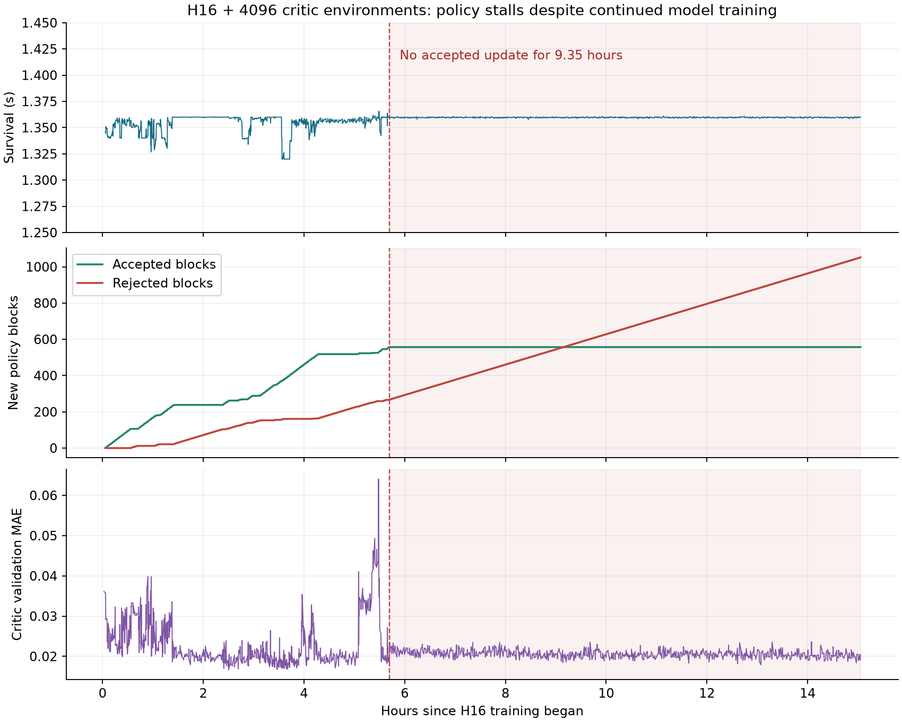
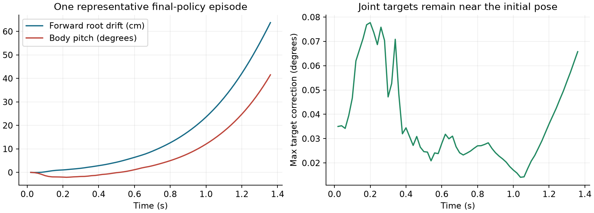

# H16 站立训练停滞：过程、物理复核与原因

2026-11-15，北京时间。用户要求停止训练并详细分析。正式服务已正常停止，最后检查点为第 **47103** 轮；本报告中的额外计算均为有限诊断，未恢复训练。

**结论：策略始终停留在“不稳定初始姿势附近的微小动作”上。物理数据大量重复约 1.3 秒的倒地过程，WM 和 critic 可以把这条失败轨迹预测得很准，却没有提供可靠的改动作方向。策略更新失败后，恢复逻辑只继续训练 WM、降低已经很低的学习率，最终形成长期循环。奖励值得改进，但没有证据表明奖励符号错误或瞄准奖励抢占站立是本次失败的主因。**

## 1. 停止状态与计数

运行目录：`logs/tienkung3_29dof/standing_aiming_fullbody_v2/dual_h16_critic4096_reward_v2_20261114`。
冻结运行代码位于该目录的 `runner/`；以下检查使用这份代码和停止后的模型副本。

| 项目 | 本次 H16 运行 |
| --- | --- |
| 起止轮次 | 4795 → 47103 |
| 新增 WM 轮次 / 优化器更新 | 42308 / 423080 |
| 候选策略批次 | 1609，每批 5 次更新 |
| 接纳 / 拒绝批次 | 557 / 1052 |
| 尝试 / 最终保留的 actor 更新 | 8045 / 2785 |
| 最后接纳 | 第 17010 轮，约 04:35 |
| 最后连续拒绝 | 786 批，约 9.35 小时 |
| 正式完整评估 | 57 次，全部未通过 A 阶段 |
| 最终平均生存时间 | 约 1.36 秒 |
| 异常重启 / OOM | 均为 0 |

累计计数还包含前一段 H8：停止时 actor 保留更新 2960 次、尝试 8740 次，WM 更新 471030 次，critic 更新 1003500 次。critic 更新次数包含后来被最佳验证快照替换的优化器步骤，不能理解成同等数量的新物理轨迹。

H16 是从 H8 第 4795 轮继续的：保留 actor 和 WM，因奖励变化重新初始化 critic、清空 actor 动量，但保留当时已经下降到 `1e-7` 的 actor 学习率。这轮不是重新随机初始化的独立实验。更早报告里有部分环境站立通过的模型来自另一条继承已有权重的试训，不能当作这条从零初始化训练已经学会站立的证据。

图中绿色曲线变平后，策略完全不再推进；critic 的低误差继续保持。前期“被接纳”只表示没有超过允许退化幅度，不代表已经进步或站稳。

## 2. 每一批训练实际做了什么

1. **GPU 0 训练世界模型。**4096 个环境执行当前策略，加身体 `0.005 rad`、右臂 `0.02 rad` 的探索；每轮采集 12 个控制步，执行 10 次 batch 4096 的 WM 更新。训练窗口 8 步，即 0.16 秒。每个环境保留最近 1000 步。
2. **GPU 1 收集 critic 标签。**4096 个环境从相同姿势、相同物理参数、相同 A 阶段目标开始。部分轨迹先加 0–64 步探索，随后执行确定性策略。使用真正终止前的完整物理回报，终止后不接入新回合。3072 个环境训练，1024 个环境验证。
3. **拟合 critic。**每 4 个物理步保存一次有效输入和回报。初次最多 5000 次更新，刷新最多 2000 次，batch 4096；按验证误差选回最佳权重。
4. **更新 actor。**从 critic 采样的有效训练起点中抽 batch 2048，通过 WM 展开 H16，即 0.32 秒，优化“16 步奖励 + critic 估计的后续回报”。连续更新 5 次。
5. **物理对照。**64 个环境分别执行原策略和候选策略。A 阶段允许小幅波动，生存时间恶化超过容许值，或没有明显生存收益且未折扣回报下降超过容许值，则撤回 actor 参数及 Adam 状态。
6. **连续失败处理。**每连续拒绝 3 批，将学习率减半但不低于 `1e-7`，额外做 100 轮 WM 训练，再重新尝试。
7. **正式评估。**每累计接纳 10 批执行完整 30 秒评估和 WM 诊断；通过两次才升级课程。

关键区别：critic 有物理监督，但 **actor 的梯度仍完全来自 WM 和 critic 的可微计算**。物理对照负责接纳或拒绝，没有把“这个动作改动实际更差”的方向信息作为额外训练约束反馈给模型。

## 3. 物理上是怎样倒下的

先绕开学习算法，直接测试固定关节目标，再复测不同阶段的策略。下表使用同一套现有物理环境、64 个并行回合；所有情况均在首次真正终止后停止计入回报。

| 控制方式 | 平均生存时间 | 站立通过 |
| --- | ---: | ---: |
| 始终保持初始姿势的关节目标 | 1.300 s | 0/64 |
| 始终保持 RobotSpec 默认关节目标 | 1.403 s | 0/64 |
| 本条训练的最初随机策略 | 1.319 s | 0/64 |
| 切换 H16 时的策略 | 1.344 s | 0/64 |
| 最终策略 | 1.359 s | 0/64 |

**初始化得到的是站立外形，不是经过稳定性验证的平衡控制器。**最后一层偏置被设为初始姿势，输出权重初始缩小至 0.01，策略从近似固定姿势开始学习。这并不意味着系统不能从零学习，但要求探索和更新能发现足够有效的平衡动作；本次没有发生。

最终策略一条代表性轨迹如下：

| 时间 | 根向前位移 | 身体俯仰 |
| --- | ---: | ---: |
| 0.6 s | 6.4 cm | 1.1° |
| 0.8 s | 12.6 cm | 5.0° |
| 1.0 s | 23.6 cm | 12.0° |
| 1.2 s | 42.1 cm | 24.8° |
| 1.36 s | 63.7 cm | 41.5° |

这时根高度从约 0.99 m 降到 0.74 m，触发高度终止。踝关节实际角度与目标的误差逐渐扩大至约 0.70 rad，而策略给出的关节目标相对初始姿势仍只变化约 `0.0003–0.0014 rad`。**机器人向前倒，策略几乎还在要求保持原姿势。**

额外预定义的 25 组髋/踝固定目标偏移（各为 −0.10、−0.05、0、0.05、0.10 rad）也未得到站稳控制器，最好约 1.44 秒。这只能排除“这几个简单固定目标就能直接解决”的可能，不能证明现有硬件参数下站立不可行，也不能据此认定仿真器或 PD 配置有错误。现有证据支持先单独核对初始姿势与平衡控制，而不是继续扩大训练规模。

## 4. 4096 个环境为何没有带来突破

停止后，用最终模型重新采集了一批正式规模的 4096 环境数据，训练/验证分组仍为 3072/1024，没有执行优化器更新。

| 指标 | 结果 |
| --- | ---: |
| 有效 critic 样本 | 44039 |
| 训练 / 验证样本 | 32972 / 11067 |
| critic 验证 MAE | 0.0210 |
| 只按回合步数查表的验证 MAE | 0.0733 |
| 只按回合步数查表解释的目标方差 | 99.67% |
| actor 起点在前 16 步的占比 | 12.12% |
| actor 起点在第 32 步及以后的占比 | 68.86% |
| actor 起点平均步数 | 39.32，即约 0.79 s |

时间查表只用训练环境拟合各步的平均回报，在验证环境计算误差；没有用验证标签拟合。

**数据量大，但变化范围很窄。**所有环境重置为同一个姿势；A 阶段目标固定，物理参数 `xi` 恒定。探索前缀以后才收样本的规则，又使训练起点偏向较晚的倒地阶段。大量样本只是回答“同样的倒地过程走到这一刻，还能获得多少分”。

critic 确实比时间查表更准确，不能因此否定它学到的状态信息；但这个结果说明低 MAE 并不足以证明它学会了平衡动作的后果。扩大环境数提高了这条窄轨迹的采样精度，没有自动提供大量成功站立或纠正失衡的例子。

## 5. 哪个环节把策略带偏了

### 5.1 在模型副本上复现原更新

使用最终 actor、WM、critic，按当前学习率 `1e-7` 和 H16，在副本上执行 5 次更新，随后做物理评估。只为诊断改变损失或优化器，不写回正式模型。诊断采集为 64 环境，actor batch 仍为 2048；因此它是机制复核，不是完整复刻每一批生产采样。

| 情况 | 未折扣物理回报，两次复测 |
| --- | --- |
| 原策略，多次对照范围 | 7.640–7.668 |
| 原算法，保留 Adam 动量 | 7.520 / 7.532 |
| 原算法，清空 Adam 动量 | 7.517 / 7.520 |
| 清空动量，并去掉 critic 末端价值项 | 7.688 / 7.680 |

所有情况仍约 1.36 秒终止。**原算法下降可以复现；旧动量不是唯一原因。去掉末端价值对当前局部更新有帮助，但远未证明这样就能学会站立。**

当前 critic 末端价值项的参数梯度范数是直接奖励项的 **2.76 倍**，总梯度与末端价值梯度余弦约 **0.950**。它仍主导方向，但已不能沿用旧 H8 诊断中“约 50 倍”的数字。通过历史输入的价值梯度仍占重要部分。

原算法 5 次更新在诊断状态上的关节目标变化最大只有 **4.45×10⁻⁶ rad**，均方根约 **1.01×10⁻⁶ rad**。当前优化实际上已经退缩到极小的局部改动；真实接触响应与模型预测的微小增益难以对应。

### 5.2 直接检查“沿 critic 建议改动作”

取 16 个物理起点，每个 4 个复现；前 16 步沿 critic 末端价值的动作梯度或逆方向扰动，关节最大幅度为 ±0.005 rad，之后执行同一个原策略直到真正终止。比较“沿梯度 − 逆梯度”：

| 尾段回报差的来源 | 均值 | 状态均值标准误 |
| --- | ---: | ---: |
| WM 推演后交给 critic | +0.14577 | 0.01377 |
| 把真实物理第 16 步状态与历史交给 critic | +0.14601 | 0.01848 |
| 真实物理尾段回报 | +0.00608 | 0.00748 |

**即使绕过 WM 的状态误差，critic 仍把这次改动作的收益估得很大，真实收益却很小、未明显超出波动。**这直接支持“价值的局部响应没有校准好”。该测试没有证明所有方向都反向，也没有证明 critic 是唯一原因；但已足以说明把 MAE 降低或环境数扩大当作方向可靠的保证是不成立的。

### 5.3 WM 能预测失败轨迹，不等于能指导恢复平衡

停止后重新执行了独立 WM 诊断，最终模型 H16 的根位置 P95 误差 **0.696 cm**、脚位置 P95 **1.131 cm**，仍通过现有阈值。

这些验证沿当前策略附近的真实动作检查预测误差，不检查“改变动作后的梯度是否准确”，也没有覆盖成功恢复平衡的广泛状态。它证实了 WM 对当前数据的预测能力，不能替代动作方向验证。

此外，生产日志中显示的最后一份 WM 诊断来自第 **17000** 轮；后面 9 小时因没有接纳策略，诊断没有刷新。上一次状态汇报直接引用了这个 `passed`，没有注明其时间，表述不充分。本报告使用的是停止后的重新验证结果。

## 6. 恢复机制为什么会一直空转

**第一，学习率从一开始就处于下限。**原 H8 初始为 `3e-6`，早期更新连续失败后已经逐级降到 `1e-7`。H16 保留这个学习率，整轮都未离开下限。继续执行 `max(min_lr, lr * 0.5)` 不再改变任何东西。

**第二，恢复操作没有处理已发现的问题。**每三次拒绝只多做 100 轮 WM 训练，没有验证 actor 梯度，没有改变失败轨迹的数据覆盖，也没有给 critic 添加针对这次动作变化的物理反馈。

H16 全程完成 **342 次**这种恢复，额外训练 WM 34200 轮，停止前又做了 63 轮。合计占本轮 WM 轮次 **80.98%**。恢复后继续提出相似的坏方向，再被物理检查撤回。

**第三，critic 的 `improved=True` 不能当作已经改善的证据。**`fit_critic()` 先把 `best` 设为更新前误差，再只保留更好的快照；刷新阶段判断条件是 `best <= before`。只要旧误差有限，即使训练完全没有改善、最终恢复旧权重，这个条件也成立。最近 500 次刷新中 **449 次**最优误差与更新前完全相同。选择最佳权重本身合理，但这个标志既不是严格进步判据，更不是梯度可信度判据。

**第四，监控和探索恢复依赖接纳事件。**正式评估、WM 诊断与探索平台判断挂在每十个接纳批次之后。策略长期不被接纳时，这些检查也停住了；身体探索幅度本来就是固定值，当前阶段内的衰减/恢复主要作用于右臂。站立阶段长期失败时，系统没有相应增强身体平衡方向的数据覆盖。

上述流程见冻结源码 `runner/supermimic/acp/train_aiming_physical.py` 的主循环、`runner/supermimic/acp/aiming_physical.py` 的 `fit_critic()` 和 `compare_candidate()`。这解释了为何服务健康、GPU 持续有计算，却没有实际策略进展。

## 7. 奖励有没有问题

已经核对真实仿真和想象使用的奖励路径，以及逐项物理回报：

- 新配置正确生效：`feet=2`、脚位置尺度 0.10 m、`aim=4`。**A 阶段实际瞄准权重为 0**，因此本轮不是为了瞄准而放弃站立。
- 物理和想象都调用同一套 `reward_terms()`，正负号、`dt` 系数一致；没有发现这次失败由奖励实现不一致造成。
- MC 标签保留终止当步奖励，在真正终止后截断，没有把 reset 后的新回合接入旧回报。
- 最终原策略一回合未折扣回报约 7.65，其中脚位置约 2.65、根位置 1.46、高度 1.01、直立 0.94。越界、关节限位、动作变化代价接近零，本轮没有证据支持这些惩罚把策略压死。
- 5 次原算法更新后的下降主要出现在脚速度、根位置、高度、直立和朝向，脚位置奖励本身几乎没变。新的失败模式不能继续简单归咎于旧的 `feet=6`。

奖励仍有训练难点：没有单独的摔倒代价；进入明显失衡以后，多项位置/直立奖励已经饱和变小，脚保持原地却还能继续拿脚位置分。当前策略可能在“怎样摔倒得稍微高分一些”上改进，而没有跨到稳定站立。前期接纳规则也允许小幅降分，并不要求每次都取得严格进步。

但这不等于奖励的最优目标是摔倒。A 阶段正奖励每步上界为 0.164，理想保持 30 秒的未折扣上界为 246，远高于约 7.65 的短暂失败回合；未来奖励被终止截断，本身也会惩罚过早结束。这个上界不是可达到性证明，但足以说明不能把缺少显式摔倒罚分直接当作唯一病因。

因此，奖励应结合真实平衡动作检查和调整；单独继续改权重，没有证据能打破当前的梯度与数据循环。

## 8. 下一步需要解决的具体问题

本轮只停止并诊断，未更改正式训练算法或继续训练。后续应按以下顺序推进：

1. **先把站立子问题验证清楚。**核对初始姿势、重心、脚接触与踝关节控制，建立能改善生存时间的物理动作对照。可以保留从零学习，但要证明它能从当前起点得到有效平衡信号；不直接把未经验证的固定姿势叫作“站立初始化”。
2. **让更新方向经得起物理检验。**使用配对动作扰动和真实后续回报，检查 WM/critic 对动作变化的响应；围绕误差设计训练，而不只拟合现有轨迹上的值。actor 的小批更新应持续改善真实生存时间，再考虑扩大训练。
3. **改变采样覆盖和有效更新尺度。**补足回合早期、不同失衡程度和身体动作方向的数据，避免绝大部分起点已经处于倒地后段。解决方向问题后重新标定 actor 学习率，不能继续继承长期停滞后的 `1e-7` 下限，也不能在方向未验证时直接大幅加大学习率。
4. **修正失败恢复与监控。**按时间或尝试次数做独立评估；区分 critic 无退化与真正改善；连续失败应触发原因诊断和数据/优化策略调整，不能无限追加同样的 WM 训练。保持不擅自停止训练的用户要求，可以明确报警和记录，不必把正常训练预算设上限。
5. **再调整奖励。**先用真实轨迹确认奖励能区分“纠正失衡”与“原地倒下”，再讨论早期平衡奖励、终止代价和各项尺度。最终 30 秒、根 10 cm、脚 5 cm、倾角 15° 的验收标准保持独立。

## 9. 证据与复现边界

原始证据位于 [results/h16_standing_failure_20261115](../../../results/h16_standing_failure_20261115)：

- [停止记录](../../../results/h16_standing_failure_20261115/stop_record.json)、[计数摘要](../../../results/h16_standing_failure_20261115/summary.json)、[逐批时间线](../../../results/h16_standing_failure_20261115/timeline.json)。
- [物理控制与倒地诊断](../../../results/h16_standing_failure_20261115/physical_audit.json)、`fall_trace.npz`、[独立 WM 复测](../../../results/h16_standing_failure_20261115/fresh_wm.json)。
- [策略更新反事实](../../../results/h16_standing_failure_20261115/policy_update/report.json)、[动作方向复核](../../../results/h16_standing_failure_20261115/h16_directions.json)。
- [4096 环境数据与时间查表对照](../../../results/h16_standing_failure_20261115/sampling_audit.json)、[复现脚本及文件哈希](../../../results/h16_standing_failure_20261115/manifest.json)。

检查点 SHA-256：`47b2495c8add2311d3a6c0cfff0edcb6145d3826e82a4501d79e774b05c4e4d9`。

所有物理复核使用标准 FP32、现有模型与控制参数；模型副本上的更新没有写回正式检查点。有限起点测试和有接触动力学的重复实验存在波动；本报告区分了已复现的局部失效、源码中确定的循环机制，以及尚待验证的改进方案，没有宣称已经找到能够通过站立验收的新控制器。
