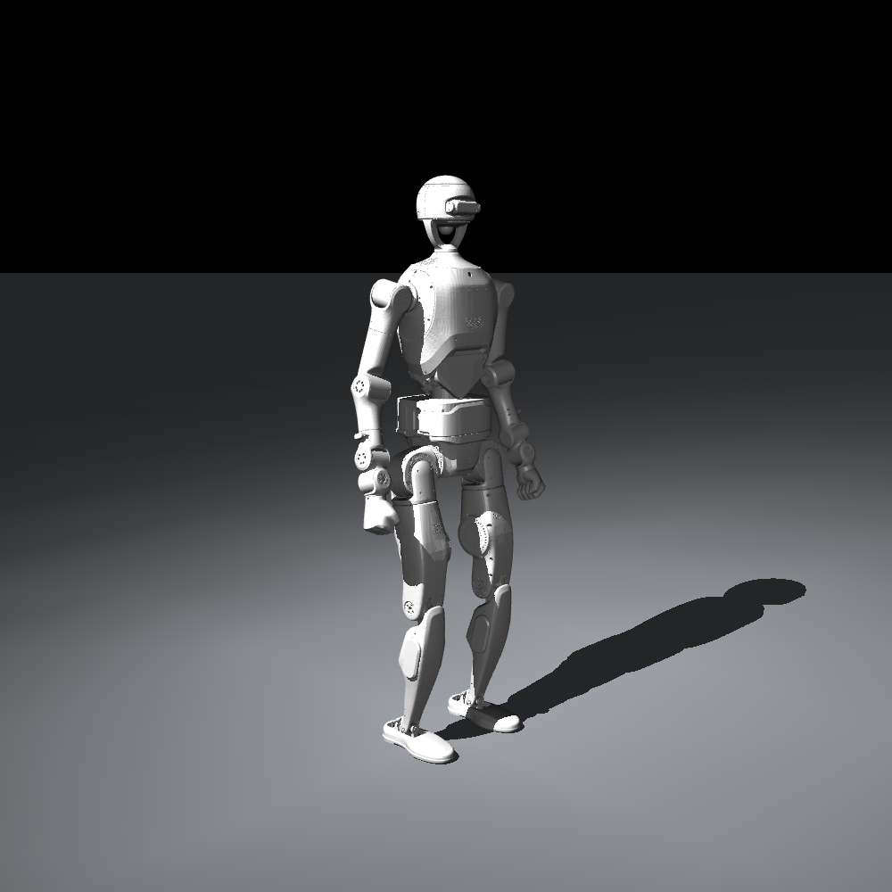

# ACP-TienKung：天工 3.0 29 DoF 复现入口

本次范围为 **M0–M3 + 合成站立链路检查**。完整迁移计划保留在 [migration_plan.md](migration_plan.md)，当前状态见 [progress.md](progress.md)。设计与持续任务上下文分别见 [design.md](design.md)、[taskmemory.md](taskmemory.md)。

## 环境与资产

```bash
conda activate acp_supermimic
python -m tools.prepare_tienkung3
python -m tools.generate_standing_motion --robot tienkung3_29dof
python -m supermimic.acp.make_labels \
  --robot tienkung3_29dof \
  --out data/tienkung3_29dof/contacts/bootstrap --workers 1
```

环境锁定见仓库根目录 `environment.yml`。本机解释器为 `/home/js/miniforge3/envs/acp_supermimic/bin/python`。转换器下载固定上游提交，保留原 URDF/网格，在 generated 生成无损 OBJ 与固定头部的派生 URDF/MJCF；不将模型网格或训练文件加入 Git。上游归档未包含 LICENSE/COPYING，来源记录保留在 manifest，未替上游添加许可。

模型规格：29 个受控 hinge + 1 个 freejoint，裸模型 `nq=36, nv=35, nu=0`，mjlab 组装后 `nu=29`。根为 pelvis，躯干为 waist_pitch_link。策略 50 Hz、物理 200 Hz；动作目标为 `q_default + joint_offset + 0.25 * action`。速度限值没有物理硬约束。armature=0 是未辨识的仿真假设。

## 验证命令

```bash
python -m tools.check_robot_numerics \
  --out docs/tienkung3_29dof/evidence/numerics.json
python -m unittest tools.test_robot_contracts tools.test_acp_pipeline

for n in 1 16 64; do
  python -m tools.check_acp_setup --robot tienkung3_29dof \
    --contacts-dir data/tienkung3_29dof/contacts/bootstrap \
    --num-envs "$n" --steps 500 \
    --out "docs/tienkung3_29dof/evidence/smoke_${n}.json"
done

python -m tools.check_acp_setup --robot g1 --num-envs 16 --steps 16 \
  --out docs/tienkung3_29dof/evidence/g1_regression.json
python -m tools.preview_robot \
  --out docs/tienkung3_29dof/evidence/default_pose.png
```

`check_robot_numerics` 默认检查 1,000 个限位内随机姿态的位置、旋转、线/角速度，另用带非零 anchor、joint ref 和多级固定链的小模型检查；九类接触各 100 个样本覆盖平面、箱体顶面、侧面、边角。接触和 FK 均执行有限差分梯度检查。误差门槛见 design.md，失败会以非零退出码返回。

`check_acp_setup` 检查真实 reset/step、观测、状态、command、两种奖励、执行器、replay，以及 policy → world model → reward/critic 的反向传播；world model step 经过 torch.compile。另用 CPU MuJoCo 的执行器输出独立检查 PD 与饱和公式。

## CLI 与身份约定

- `--robot` 已接入训练、标注、动作清理、评估、渲染、检查和流水线；旧调用默认 G1，评估/渲染由文件元信息解析身份。
- 关节按名字双向重排，不能把两个机器人的 29 维数组视为兼容。
- 新文件/checkpoint 带 robot_id、model/config hash、canonical joint order、control_dt；checkpoint 记录数据哈希，标签绑定 motion/terrain 文件哈希。旧无身份文件只允许走 G1 路径。
- `MotionLib` 支持 `(T,36)` motion 和 `(0,1,10)` 空平地 terrain；合成站立为 601 帧、50 Hz。末帧不能作为有后继动作的 reset 起点。
- 运行目录绑定模型、配置、输入文件；更换输入不能复用旧流水线完成标记。正式流水线仍为 Stage 1 → offline planner → Stage 2；本次未新增或运行完整 Stage 3 流水线。

## 交付边界

合成站立文件是常值参考姿态，**不是已验证可执行的稳定站立控制器**。零动作检查中的跌倒和 reset 会如实报告；通过表示接口和数值链路正常，不表示站立/步行/攀爬能力通过。真实动作质量、任务尺度阈值、重定向、Stage 1–3 正式训练和实机部署均留待后续。

接触近似通过目标模型的样本验收，也不等于任意深度穿入、任意机器人和地形上的精确凸体求距。仿真维持无自碰撞策略；后续动作质检和实机工作仍需独立检查非相邻 link 自碰撞与可承载接触区域。

## Git 管理

工作分支 `feat/tienkung3-29dof-acp`。`origin` 为用户指定的 `JStone2934/ACP_supermimic_Tienkung`（HTTPS fetch，SSH push）；原仓库保留为 `upstream`。既有工作区改动已单独保存为 `98f38d2`，原始文件哈希见 evidence/baseline.json。没有强推或直接修改远程 main。

## 默认姿态



## 已验证结果与短训练复现

[进度与验收表](progress.md) 和 [完整运行清单](evidence/run_manifest.json) 记录实际结果。M0–M3 数值验收、15 项回归测试、1/16/64 环境检查通过。合成参考不依赖真实动作库，因此可以先完成软件接入。

运行清单中保存了小规模训练、恢复、评估和录像的完整命令。训练只做 3 次更新后恢复至第 4 次，不是正式训练；评估在约 1.40 s 失败，未达到稳定站立能力。使用 `--resume` 时数据哈希必须一致；显式 `--init` 可在同模型的新数据上微调。

视频复现须先激活 conda 环境，确保 ffmpeg 位于 PATH。实际评估轨迹和视频保留于本地 `results/tienkung3_tiny_policy.npz` / `results/tienkung3_tiny_policy.mp4`，证据目录记录哈希与编码检查结果。模型/动作/标签/checkpoint/视频不随代码推送；新机器应按本页命令重建资产和合成数据。

## 公开动作数据调研（2026-11-07）

已找到官方天工 3.0 的现成 29 DoF 动作示例；本次检索尚未找到与 G1 PHP 的 296 段动作及配套地形相当的天工跑酷数据包。以下是候选数据，不代表已完成转换、正式训练或动力学验收。

### 优先候选：xMimic 29 DoF

[固定版本下载目录](https://github.com/Open-X-Humanoid/xMimic/tree/0385122a232279210e941c7bb28da6a0bbb42356/motion_example/29dof) 包含以下三个 NPZ。本次已下载并实际读取，帧率均为 100 Hz；时长按 `(T-1)/fps` 计算。

| 文件 | 帧数 | 时长 | 相对本地目标模型的最大关节越限 |
|---|---:|---:|---:|
| `dance1_easy.npz` | 3,982 | 39.81 s | 1.12° |
| `dance2_medium.npz` | 7,099 | 70.98 s | 4.00° |
| `weibst_hard.npz` | 1,335 | 13.34 s | 5.00° |

三个文件的 29 个关节名均与本地模型一致，但排列不同。包含 `joint_pos`、`joint_vel`、`body_pos_w`、`body_quat_w`、body 线角速度及 joint/body 名称；所有数值有限、四元数归一化正常。源 `joint_pos` 为 `(T,29)`，根部世界位姿在名为 `pelvis` 的 body 数据中。没有随示例发布 PHP 箱体地形或本项目接触标签。

接入步骤：

1. 对照模型版本和关节定义，按名称重排关节，提取 pelvis 根部位姿。
2. 组合为 `(T,36)` 的 `root_xyz + root_quat_wxyz + joint_angles`，统一至 50 Hz。
3. 检查并处理限位、地面穿透、脚滑和自碰撞；不能用添加模型元数据代替模型兼容性验证。
4. 写入本项目要求的机器人身份信息及空平地 terrain，以目标模型重算 FK、速度和接触标签。
5. 先验证 `dance1_easy` 的小规模跟踪，再扩展动作难度。

尚未实现 xMimic 自动转换器，现有 `tools/download_acp_data.sh` 仍只下载 G1/PHP 数据。本次检查证明数据可读取且关节名可映射，不证明动作能稳定执行。xMimic README 标注 MIT，但所检查提交没有独立 LICENSE/COPYING 或动作数据许可文件，因此这里只确认公开可下载，不额外推定数据授权范围。

### 其他来源与用途

- [TienKung-Lab 天工 3 数据](https://github.com/Open-X-Humanoid/TienKung-Lab/tree/ffea8bde32fcb632b5ef2a700e452f99e907ea40/legged_lab/envs/tienkung3/datasets)：包含 walk/run。此前核验的 visualization walk 有 736 帧，`FrameDuration=0.033`，包含 root 与 20 个关节位置，需要补齐腰部和其余关节。AMP expert 文件不包含同样的完整 root 世界轨迹，不能因维度相同而混用。
- [HEX 天工 3 数据](https://huggingface.co/datasets/X-Humanoid/HEX-Datasets/tree/main/pretrain/tiangong3)：当前列出 19 个任务目录。抽查 `dex7_pick_up_toy_while_walking` 的 `meta/info.json` 与 `meta/modality.json`，为 99 episodes、40,412 帧、30 Hz，state 45 维、action 19 维。state 包含双腿关节，但没有明确说明的 root 世界位姿字段。适合操作/VLA 研究，不能直接替代 PHP 参考库；[官方说明](https://github.com/Open-X-Humanoid/HEX/blob/fe9ee4870c90f2c4c362e36e3202324523c0dda9/readme.md) 中天工底层全身控制器未开放。
- [xGMR 注册表](https://github.com/Open-X-Humanoid/xGMR/blob/70f08d75f5e03aa06ed6d521451bd1e6888f5c0f/general_motion_retargeting/params.py)：仍未注册 xMimic README 示例中的 `tiangong3`。人体动作扩充路线需要先补齐真实可用的目标模型与 IK 配置，不能把旧天工型号直接当作 3.0。

建议用 xMimic 示例与官方 walk 启动真实动作验证；PHP 台阶、翻越、攀爬能力继续依赖 G1 → 天工的接触约束重定向或新采集数据。本节补充此前迁移报告未列出的 xMimic 现成 NPZ，不改变已完成的 M0–M3 验收范围。
